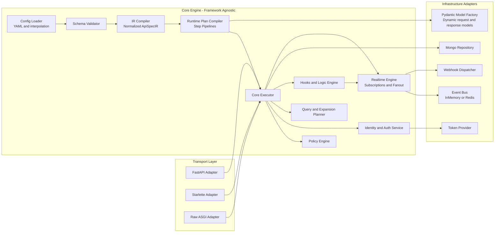
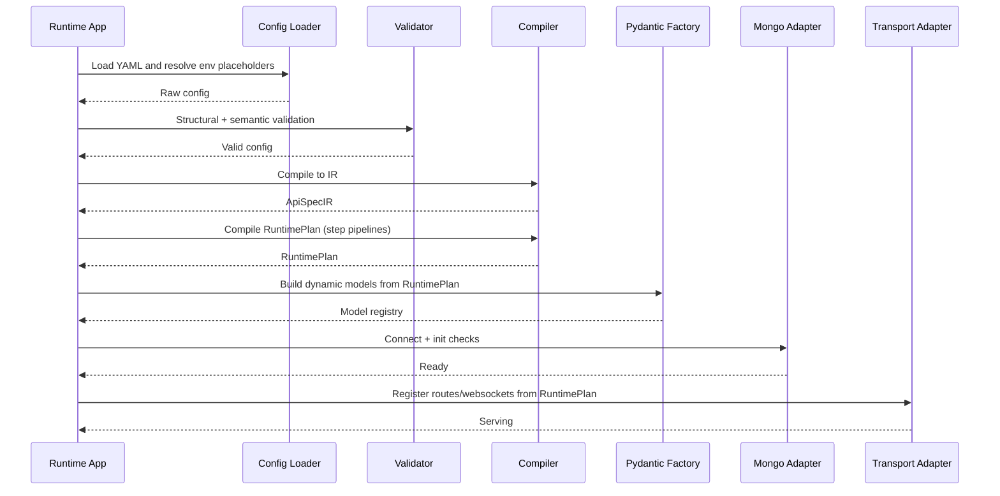
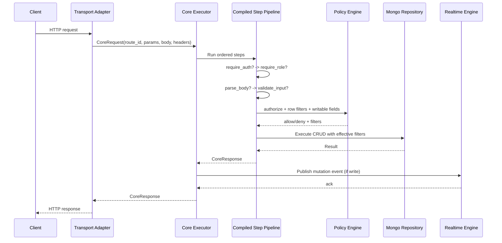
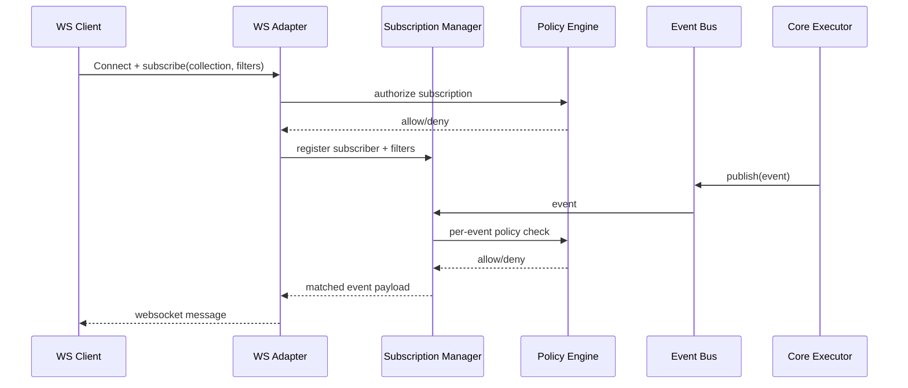

# Architecture Diagrams

## 1) Module/Container View



## 2) Startup Flow (Runtime-Only MVP)



## 3) HTTP Request Pipeline



## 4) Realtime Flow



## 5) Future Build-Time Compilation Path

```mermaid
flowchart LR
    YAML[YAML] --> V[Validate]
    V --> IR[Compile IR]
    IR --> ART[Emit Artifact\n(JSON/code)]
    ART --> BOOT[Runtime Boot]
    BOOT --> PLAN[Load RuntimePlan]
    PLAN --> SERVE[Serve Requests]
```
