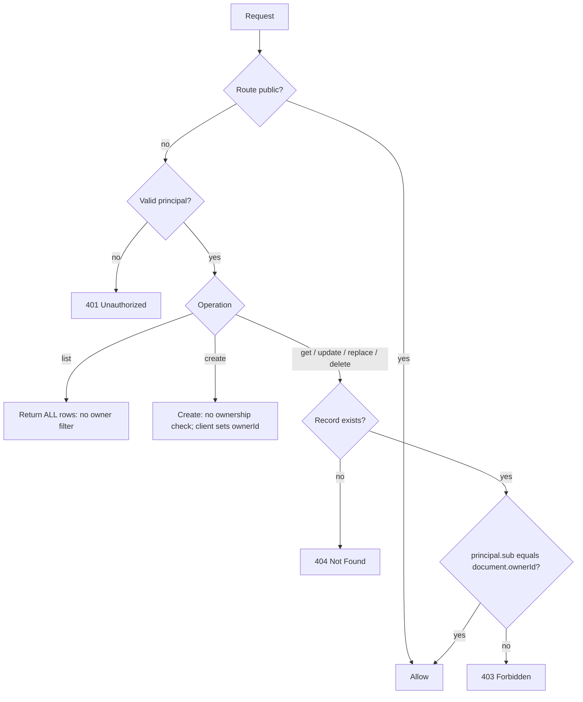

A multi-user todo API where each user owns their own lists and items. Single-record
reads and writes are guarded by an ownership `when` rule; list endpoints are
authenticated but not owner-filtered (see "Where ownership is enforced" below).

## Features

- Each user has private todo lists, and each list contains items
- Ownership rules restrict get/update/delete on a list or item to its owner
- No cross-user roles or shared lists (ownership is the only access dimension)

The full spec is in [Full Spec](./02-spec.md). It does not declare an `api:` block,
so it uses the default `api.basePath` of `/api` and no version segment. The tables
below assume you add an explicit `api:` block so the URLs are reproducible:

```yaml
api:
  basePath: /api
  version: v1
```

With that block the routes are prefixed `/api/v1`. Drop the `version:` line to get
the spec's default `/api` prefix instead.

> **Enforcement status**
>
> Roles (exact match), `<entity>:*` scoping, and ownership/ABAC `when` rules
> are enforced by the generated FastAPI backend, the generated DRF backend, and the
> `stackform run` dev server alike. A request that fails a rule gets 401 (missing or
> invalid credentials), 403 (authenticated but not allowed), or 404 (record not
> found, checked before ownership). Two current limitations: role hierarchy (for
> example `admin` inheriting `moderator`) is accepted in YAML but not yet applied
> during enforcement -- only exact role matches are checked; and conditional or
> ownership rules require a v0.2 spec, because v0.1 specs do not parse `when` rules.

## Entities

| Entity | Type | Description |
|--------|------|-------------|
| `user` | auth | App users with password login |
| `list` | data | A named collection of todos, owned by a user |
| `item` | data | A single todo item belonging to a list |

## Endpoints

### Auth

The spec's `users` controller lists `register` and `login`, but those endpoints are
only generated when you also enable them under `api.operations.auth`. Add this to
the spec to get the routes below:

```yaml
api:
  basePath: /api
  version: v1
  operations:
    auth:
      register: true
      login: true
```

| Method | Path | Access |
|--------|------|--------|
| POST | /api/v1/users/register | public |
| POST | /api/v1/users/login | public |

Login returns `{"token": "<jwt>", "user": {...}}`. The `user` object excludes the
password, `_id`, and the internal `_auth` block. Send the token as
`Authorization: Bearer <jwt>` on subsequent requests.

Without the `api.operations.auth` block, register and login do NOT exist. The
`users` controller does not otherwise restrict CRUD: every CRUD operation it exposes
inherits the controller default `access: public`, so `GET/POST/PATCH/PUT/DELETE
/api/v1/users` are all publicly callable. To lock users down, set `access` on the
controller or disable the extra operations (see [Full Spec](./02-spec.md)).

### Lists

| Method | Path | Access |
|--------|------|--------|
| GET | /api/v1/lists | authenticated (NOT owner-filtered; returns all lists) |
| GET | /api/v1/lists/{id} | owner only (404 if missing, 403 if not owner) |
| POST | /api/v1/lists | authenticated (no ownership check on create) |
| PATCH | /api/v1/lists/{id} | owner only |
| PUT | /api/v1/lists/{id} | authenticated (replace inherits `access: "*"`) |
| DELETE | /api/v1/lists/{id} | owner only |

### Items

| Method | Path | Access |
|--------|------|--------|
| GET | /api/v1/items | authenticated (NOT owner-filtered; returns all items) |
| GET | /api/v1/items/{id} | owner only |
| POST | /api/v1/items | authenticated (no ownership check on create) |
| PATCH | /api/v1/items/{id} | owner only |
| PUT | /api/v1/items/{id} | authenticated (replace inherits `access: "*"`) |
| DELETE | /api/v1/items/{id} | owner only |

All six CRUD operations are enabled by default, including `replace` (PUT). The list
controllers set `access: "*"` (any authenticated user) and override only `list`,
`get`, `update`, and `delete` with the ownership rule, so `create` and `replace`
keep the `"*"` default.

## Where ownership is enforced

The ownership rule is `principal.sub equals document.ownerId`. It is a document rule:
it can only be checked once the target record has been fetched. The generated backend
fetches and applies it for `get`, `update`, `replace`, and `delete` (the single-record
operations), but NOT for `list` or `create`:

- `GET /api/v1/lists` and `GET /api/v1/items` require a valid token but return ALL
  rows. They are not filtered to the caller's documents. A document rule on `list`
  only gates whether the operation runs, not which rows come back.
- `POST` (create) has no post-fetch step, so no ownership check runs. The server
  does NOT auto-fill `ownerId` from the principal -- the client must send an
  `ownerId` that matches its own `sub`, or the record is created owned by someone
  else (or nobody).
- `GET /{id}`, `PATCH /{id}`, `PUT /{id}`, and `DELETE /{id}` fetch the record first
  (404 if it does not exist), then enforce the ownership rule (403 if the caller is
  not the owner).



## Key design decisions

- `list.ownerId` links lists to users; `item.listId` links items to their list.
- `item.ownerId` is denormalized onto each item so ownership checks need no join.
- Access is purely ownership-based; there are no roles. Single-record access is
  enforced; list endpoints are authenticated only.
