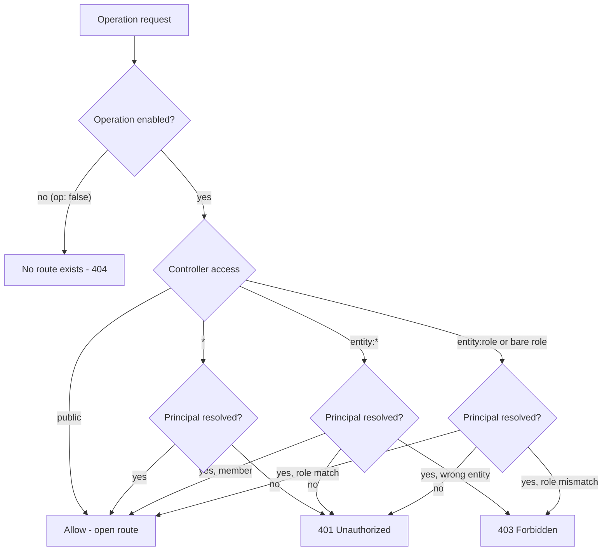

Once your spec contains any `type: auth` entity, the generated app protects every
route by default. You opt a route out of protection only by giving it the literal
`access: public`. There is no implicit "open unless stated" mode; the burden is on
you to mark routes public, not to mark them protected.

## The rule

A route is protected (requires a valid principal) when both are true:

- The route is not declared `access: public`.
- An identity collection exists in the spec (at least one `type: auth` entity).

Internally the generated app computes this as `needs_auth = not is_public and
has_identity`. The second half matters: with no auth entity in the spec, there is
nothing to authenticate against, so even a non-public route stays open. Add a single
`type: auth` entity and every route that is not `access: public` immediately starts
requiring credentials.

```yaml
version: "0.2"

api:
  basePath: /api
  version: v1

entities:
  myEntity:
    type: auth
    auth:
      identifier: email
      via: password
    fields:
      id: { type: id }
      email: { type: string, required: true, unique: true }

  myCollection:
    fields:
      id: { type: id }
      title: { type: string, required: true }
```

With the `myEntity` entity present, `GET /api/v1/my-collection` now returns 401
unless the caller presents valid credentials. Remove the `myEntity` entity and the
same route is open to anyone.

## Effective access resolution



The default FastAPI build, the DRF build, and `yaml-api run` all follow this same
resolution. A request with no credentials on a protected route stops at the "401
if no principal" node; an authenticated request that does not satisfy the role or
`<entity>:*` scope gets 403.

## Access vocabulary

The `access:` value on a controller (or per operation) is drawn from this
vocabulary:

| Value | Meaning |
|-------|---------|
| `public` | No authentication. The only way to opt a route out of protection. |
| `"*"` | Any valid principal from any auth entity. |
| `<entity>:*` | Any principal whose identity collection is `<entity>` -- any member of that auth entity. |
| `<entity>:<role>` | A principal of `<entity>` whose role (exact match) is `<role>`. |
| `<role>` | Bare role; allowed only when a single auth entity exists (otherwise `ACCESS_AMBIGUOUS_ROLE`). |

Roles come from the entity's enum field named by `auth.roles: <enumFieldName>` (with
fallback to a `roles` or `role` field). The standalone entity-level `roles:` block is
not wired in v0.2. See [Roles overview](../roles/overview.md).

## Minified controller default

A controller written in its minified form (just a repository reference, no explicit
`access:`) defaults to `access: public`. This is the most common way a route is
left open by accident.

```yaml
controllers:
  myCollection: myCollection        # minified -> access defaults to public
```

If you want `myCollection` protected, declare the access explicitly:

```yaml
controllers:
  myCollection:
    repository: myCollection
    access: "*"
```

You can also tighten or loosen individual operations:

```yaml
controllers:
  myCollection:
    repository: myCollection
    access: "*"
    operations:
      list: { access: public }      # reads open, writes protected
      delete: { access: user:admin }
```

> **Enforcement status**
>
> Roles (exact match), `<entity>:*` scoping, and ownership/ABAC `when` rules
> are enforced by the generated FastAPI backend, the generated DRF backend, and the
> `yaml-api run` dev server alike. A request that fails a rule gets 401 (missing or
> invalid credentials), 403 (authenticated but not allowed), or 404 (record not
> found, checked before ownership). Two current limitations: role hierarchy (for
> example `admin` inheriting `moderator`) is accepted in YAML but not yet applied
> during enforcement -- only exact role matches are checked; and conditional or
> ownership rules require a v0.2 spec, because v0.1 specs do not parse `when` rules.

## See Also

- [Auth overview](./overview.md)
- [Login, SSO, and the token flow](./login-and-sso.md)
- [Access control](../controllers/access-control.md)
- [Controllers overview](../controllers/overview.md)
- [Roles overview](../roles/overview.md)
