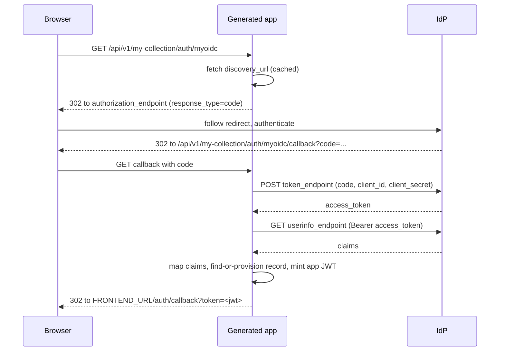
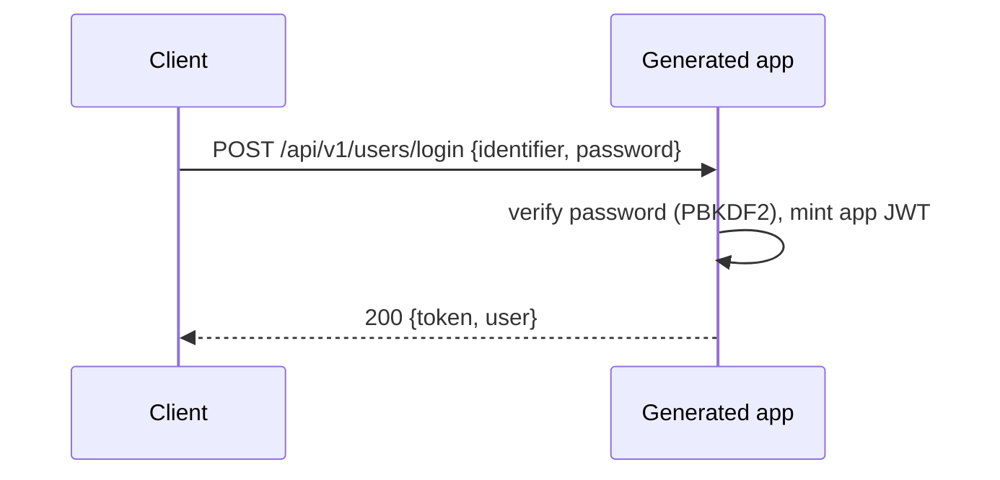

This page ties together every way a principal obtains a token: built-in password
login, OIDC single sign-on, and SAML single sign-on. All three end the same way --
the app mints its own HS256 JWT and the caller presents it as a Bearer token on
subsequent requests.

Throughout this page the URLs assume:

```yaml
api:
  basePath: /api
  version: v1
```

so paths are `{basePath}/{version}/...` -> `/api/v1/...`. With `version` omitted,
drop the `/v1` segment.

## Enabling the login endpoints

Register and login are NOT generated by default. Turn them on with
`api.operations.auth`:

```yaml
api:
  basePath: /api
  version: v1
  operations:
    auth:
      register: true
      login: true
```

- `register` reuses the entity's `create` pipeline, so it accepts the same fields
  plus the implicit `password` (for password auth). Path: `POST /api/v1/{collection}/register`.
- `login` adds `POST /api/v1/{collection}/login`.

The examples below use a collection named `my-collection` (so URLs read
`/api/v1/my-collection/...`).

## Password login

```bash
curl -X POST http://localhost:8000/api/v1/my-collection/login \
  -H 'Content-Type: application/json' \
  -d '{"email": "alice@example.com", "password": "s3cr3t"}'
```

On success the response is the token plus the matched record:

```json
{
  "token": "eyJhbGciOiJIUzI1NiIsInR5cCI6IkpXVCJ9...",
  "user": {
    "id": "0190...",
    "email": "alice@example.com"
  }
}
```

The `user` object excludes `password`, `_id`, and the internal `_auth` namespace.
A wrong password or unknown identifier both return 401 with an indistinguishable
message (no user enumeration).

## JWT claims

The minted token carries identity only:

```json
{
  "sub": "<primary key value>",
  "identity_collection": "<collection name>",
  "iat": 1700000000,
  "exp": 1700086400
}
```

- `sub` is the record's id-field value; access rules read it as `principal.sub`.
- `identity_collection` names which auth entity the principal belongs to.
- Roles are NOT in the token. On every request the app re-loads the record from
  MongoDB and re-reads the role from the entity's role field, so a role change takes
  effect on the next request without re-issuing a token.

Tokens are signed HS256 with `JWT_SECRET` and expire after `JWT_EXPIRATION_HOURS`
(default 24). See [Environment variables](../configuration/environment-variables.md).

## Credential resolution order

On each request the generated app resolves a principal by trying credentials in
this fixed order; the first that resolves a record wins:

1. `Authorization: Bearer <jwt>` -- a valid app JWT.
2. `X-API-Key: <key>` (or `Authorization: Bearer <key>`) -- matched against the
   top-level `apiKey` field of an apiKey auth entity.
3. `Authorization: Basic <base64(identifier:password)>` -- per-request password
   verification against a password auth entity.

If none resolve, the request is unauthenticated and protected routes return 401.

## OIDC single sign-on

Attach an OIDC provider to the auth entity through `auth.bindings` (not `via`).
`discovery_url` is effectively required -- the app fetches the provider's
`.well-known/openid-configuration` from it at request time; there is no built-in
inference for "well-known" providers.

```yaml
providers:
  myoidc:
    type: oidc
    client_id: my-app
    client_secret: "${OIDC_CLIENT_SECRET}"
    discovery_url: "${OIDC_DISCOVERY_URL:-https://idp.example.com/.well-known/openid-configuration}"

entities:
  myEntity:
    type: auth
    auth:
      identifier: email
      via: password
      bindings:
        - provider: myoidc
          identifier: email
          claim_mapping:
            email: email
            name: name
          auto_provision: true
    fields:
      id: { type: id }
      email: { type: string, required: true, unique: true }
      name: { type: string }
```

`auto_provision` defaults to `true`. When a login succeeds at the IdP but no local
record matches, an `auto_provision: false` binding returns 403 ("User not found and
auto-provisioning is disabled") rather than creating a record.

The authorization-code flow:



Notes on the callback:

- Claims are copied into the new/looked-up record only for keys present in
  `claim_mapping`. A claim absent from the IdP response is omitted (not set to null).
- If `claim_mapping` does not fill the binding's `identifier`, the app falls back to
  the `email`, then `login`, then `sub` claim for the identifier value.
- A provisioned record gets a server-generated id (uuid4).
- Token exchange failure, userinfo failure, or an expired token each return 401.
- The final redirect target is `{FRONTEND_URL}/auth/callback?token=<jwt>`. If
  `FRONTEND_URL` is unset, the app's own base URL is used. The React login page reads
  the `token` query parameter and stores it.

### Password login inset

Password login is the non-redirect counterpart of the OIDC flow: instead of bouncing
through an IdP, the browser (or any client) posts credentials directly and receives
the same shaped `{token, user}` JSON.



### GitHub special case

GitHub does not implement OIDC. When the provider name is `github`, the app skips
the discovery `userinfo_endpoint` and fetches the profile from
`https://api.github.com/user` using the access token. Everything else (claim
mapping, provisioning, JWT minting, redirect) is identical.

## SAML single sign-on

A SAML provider needs `idp_metadata_url` and `sp_entity_id`:

```yaml
providers:
  mysaml:
    type: saml
    idp_metadata_url: "${SAML_METADATA_URL}"
    sp_entity_id: my-app

entities:
  user:
    type: auth
    auth:
      identifier: email
      via: password
      bindings:
        - provider: mysaml
          identifier: email
          claim_mapping:
            email: email
          auto_provision: true
    fields:
      id: { type: id }
      email: { type: string, required: true, unique: true }
```

SAML routes (all under `/api/v1/{collection}/auth/{provider}`):

| Method | Path | Description |
|--------|------|-------------|
| GET | `.../auth/{provider}` | Begin login; 302 to the IdP. |
| POST | `.../auth/{provider}/callback` | Assertion Consumer Service. Returns JSON `{token, user}`. |
| GET | `.../auth/{provider}/metadata` | Service-provider metadata XML. |

The ACS callback returns the app JWT and the record as JSON (the `_id` and `_auth`
fields are stripped), rather than a 302 redirect. A SAML error or a failed assertion
returns 401; `auto_provision: false` with no matching record returns 403. The
identifier falls back to the SAML NameID when `claim_mapping` does not supply it. IdP
metadata is fetched at request time from `idp_metadata_url`.

## Listing configured providers

When an entity binds one or more external providers, the app also exposes:

```
GET /api/v1/{collection}/auth/providers
```

It returns a list of `{name, type}` objects (for example
`[{"name": "myoidc", "type": "oidc"}]`). The generated React login page calls this
endpoint to render one SSO button per provider, alongside the password login form.

## Environment variables

| Variable | Used by | Purpose |
|----------|---------|---------|
| `JWT_SECRET` | all login paths | HS256 signing secret. Set a strong value in production. |
| `JWT_EXPIRATION_HOURS` | all login paths | Token lifetime in hours (default 24). |
| `PASSWORD_HASH_ROUNDS` | password register/login | PBKDF2 iteration count (default 390000). |
| `FRONTEND_URL` | OIDC callback | Base for the `.../auth/callback?token=` redirect. |

Provider `${VAR}` placeholders (such as `client_secret` and `discovery_url`) are
interpolated from the environment at generation time.

## See Also

- [Authentication required by default](./auth-required-by-default.md)
- [Password provider](./password-provider.md)
- [API key provider](./apikey-provider.md)
- [Claim mapping](./claim-mapping.md)
- [OIDC provider](../providers/oidc.md)
- [SAML provider](../providers/saml.md)
- [Environment variables](../configuration/environment-variables.md)
