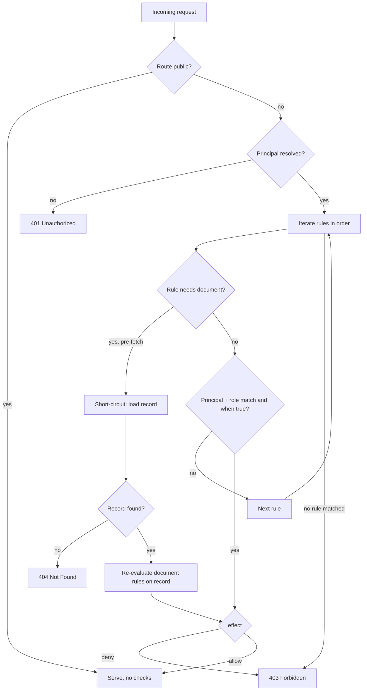

`access:` determines who is allowed to call each route. You declare it on a controller (the default for every operation it exposes) and you can override it per operation.

> **Enforcement status**
>
> Roles (exact match), `<entity>:*` scoping, and ownership/ABAC `when` rules
> are enforced by the generated FastAPI backend, the generated DRF backend, and the
> `yaml-api run` dev server alike. A request that fails a rule gets 401 (missing or
> invalid credentials), 403 (authenticated but not allowed), or 404 (record not
> found, checked before ownership). Two current limitations: role hierarchy (for
> example `admin` inheriting `moderator`) is accepted in YAML but not yet applied
> during enforcement -- only exact role matches are checked; and conditional or
> ownership rules require a v0.2 spec, because v0.1 specs do not parse `when` rules.

The URLs shown on this page assume this `api:` block:

```yaml
api:
  basePath: /api
  version: v1
```

That produces routes under `/api/v1/...` (for example `PATCH /api/v1/my-collection/{id}`).

## Prerequisite: an identity collection

Access rules are only wired up when the spec declares at least one `type: auth`
entity (an identity collection). With no auth entity, even a non-public route is
left open -- there is no principal to check against. Once an identity collection
exists, every route that is not `access: public` requires a valid principal.

## Syntax

### Simple values

```yaml
access: public              # no auth required
access: "*"                 # any authenticated principal
access: myEntity:*          # any principal from the myEntity identity collection
access: admin               # principal with admin role (single auth entity)
access: myEntity:admin      # principal with admin role (explicit entity)
```

### List of rules

```yaml
access:
  - moderator
  - given:
      principal: identity:user
      document: myCollection
    when: principal.sub equals document.ownerId
    then: allow
```

### ABAC rule with deny

```yaml
access:
  - admin
  - given:
      principal: identity:user
      document: myCollection
    when: principal.sub not equals document.ownerId
    then: deny
  - then: allow
```

## Behavior

- **Parse time:** Access values are parsed and validated. Entity names in scoped roles and in `given` bindings are checked against declared auth entities. An unscoped role name with multiple auth entities raises `ACCESS_AMBIGUOUS_ROLE`; a role with no auth entities raises `ACCESS_NO_AUTH_ENTITY`.
- **Runtime:** Rules are evaluated top-to-bottom. The first matching rule determines the outcome (allow or deny). If no rule matches, the request is denied. An unauthenticated request to a non-public route is rejected with 401 before any rule runs.

## Options

### Access value types

| Value | Description |
|-------|-------------|
| `public` | No authentication required. Any request is allowed. |
| `"*"` | Any authenticated principal from any auth entity. Returns 401 if no valid credentials. |
| `entityName:*` | Any authenticated principal from a specific auth entity. |
| `roleName` | Principal with this role (single auth entity only; entity prefix optional). |
| `entityName:roleName` | Principal with this role from a specific entity (required with multiple auth entities). |
| list | Multiple rules evaluated top-to-bottom. |

### ABAC rule fields (`given`/`when`/`then`)

| Field | Required | Type | Description |
|-------|----------|------|-------------|
| `given.<symbol>` | no | `identity:<entityName>` or `<collection>[ by <param>]` | Binds a symbol used in `when:`. The symbol name is yours to choose. |
| `when` | no | string or list of strings | Condition expression. List entries are ANDed. See [when expressions](../when-expressions/overview.md). |
| `then` | no | `"allow"` (default) or `"deny"` | Effect when the rule matches. |

Symbol names in `given` are arbitrary. The two well-known roots `principal` and
`document` are auto-bound when referenced in `when:` even if you do not name them
in `given` -- `given` is for binding additional or custom symbols. The conventional
form uses `principal:` for the caller and `document:` for the route's record:

```yaml
given:
  principal: identity:user        # binds the authenticated principal
  document: myCollection          # binds the route's myCollection record
```

A `<collection> by <param>` document binding loads a record by a different path
parameter (for example `given: { owner: myOtherCollection by myRefId }`).

### Parsed but not enforced

`filter`, `writeFields`, and `reason` are accepted on a rule object and validated,
but they do not affect enforcement in the generated backend. Use `then: deny` for
explicit denials; do not rely on `filter`/`writeFields` to scope reads or writes.

## Evaluation Order

1. If the route is `public`, it is served with no checks.
2. Otherwise a principal must be present, or the request is rejected with 401.
3. Rules in the `access:` list are evaluated top-to-bottom.
4. The first rule that matches the principal and whose `when:` evaluates true wins. `then: allow` (the default) serves the request; `then: deny` returns 403.
5. If no rule matches, the request is denied with 403.

### Document rules and short-circuiting

A rule that needs the route's record (it has a `document:` binding, or its `when:`
references `document.*`) is handled in two phases:

- During the pre-fetch pass, the first such rule short-circuits to allow so the
  record can be loaded. This means you should place cheap, principal-only rules
  (role checks) BEFORE document rules.
- The record is then fetched. If it does not exist (wrong id on
  get/update/replace/delete), the request returns 404 -- the record is fetched
  before ownership is evaluated.
- After the fetch, document rules are re-evaluated against the loaded record.

`create` has no existing record, so document rules never run for create. Use
principal-only rules (roles, `<entity>:*`) for create access.



This evaluation runs identically in the generated FastAPI backend, the generated
DRF backend, and `yaml-api run`.

## Controller vs Operation Precedence

A controller-level `access:` is the default for every operation it exposes.
Operation-level `access:` completely replaces it for that operation. There is no
merging. A controller written without an `access:` key defaults to `public`, so
lock it down explicitly if its operations should require auth.

```yaml
controllers:
  myCollection:
    service: myCollection
    access: public           # default for all operations
    operations:
      create: { access: "*" }   # overrides: only authenticated users
      # list, get use access: public (inherited from controller)
```

## 401 vs 403 vs 404

| Status | Condition |
|--------|-----------|
| 401 Unauthorized | Credentials are missing or invalid (not authenticated). |
| 403 Forbidden | Credentials are valid but the principal does not satisfy the access rule (not authorized). |
| 404 Not Found | A document rule's target record does not exist (fetched before ownership is checked). |

## Examples

### Public read, authenticated write

```yaml
api:
  basePath: /api
  version: v1
controllers:
  myCollection:
    service: myCollection
    access: public
    operations:
      create: { access: "*" }
      update: { access: "*" }
      replace: { access: "*" }
      delete: { access: "*" }
```

This protects `POST /api/v1/my-collection`, `PATCH /api/v1/my-collection/{id}`,
`PUT /api/v1/my-collection/{id}`, and `DELETE /api/v1/my-collection/{id}` while leaving
`GET /api/v1/my-collection` and `GET /api/v1/my-collection/{id}` public.

### Role-based with owner override

```yaml
controllers:
  myCollection:
    service: myCollection
    access: public
    operations:
      update:
        access:
          - moderator
          - given:
              principal: identity:user
              document: myCollection
            when: principal.sub equals document.ownerId
```

Moderators pass the first rule (no record load). Owners pass the second rule
after the `myCollection` record is fetched.

### Deny pattern: block non-owners

```yaml
update:
  access:
    - admin
    - given:
        principal: identity:user
        document: myCollection
      when: principal.sub not equals document.ownerId
      then: deny
    - then: allow
```

Rule 1: admins pass immediately. Rule 2: non-owners are denied. Rule 3: everyone
else (the owner) reaches the fallback `then: allow`.

### Membership with `in`

```yaml
access:
  - given:
      principal: identity:user
    when: principal.record.status in ['active', 'trial']
```

`in` and `not in` test the resolved field value against the listed single-quoted
strings. Stored principal fields are read through `principal.record.<field>`; bare
`principal` resolves to the principal's subject id (`sub`).

### Multiple auth entities

When multiple auth entities exist (for example `user` and `apiClient`), the entity
prefix is required on role-based access rules. If both entities define an `admin`
role, writing `access: admin` is ambiguous -- the engine does not know which entity
you mean. `user:admin` eliminates the ambiguity. Using an unscoped role name with
multiple auth entities raises `ACCESS_AMBIGUOUS_ROLE` at parse time.

```yaml
controllers:
  myCollection:
    service: myCollection
    operations:
      delete:
        access:
          - user:moderator
          - apiClient:enterprise
          - given:
              principal: identity:user
              document: myCollection
            when: principal.sub equals document.ownerId
```

## Edge Cases

- **Rules evaluated top to bottom.** The first matching rule determines the outcome. Place cheap checks (role-based, no record load) before document-level checks; a document rule short-circuits the pre-fetch pass.

- **No rule matches: deny.** If no rule in the list matches, the request is denied. Unauthenticated requests get 401; authenticated-but-unmatched requests get 403.

- **`then: allow` is the default.** If `then:` is omitted in a `given`/`when` rule, it defaults to `allow`.

- **`then: deny` explicitly denies.** Useful for "everyone except X" patterns. If the `when` condition matches, the request is denied with 403.

- **`given` without `when`.** Matches whenever the principal binding is satisfied. For example, `given: { principal: identity:user }` with no `when:` matches any authenticated principal from the `user` entity.

- **Missing document is 404, not skipped.** On get/update/replace/delete, the record is fetched before ownership rules run. If the id does not resolve to a record, the response is 404.

- **`create` has no document.** On `create`, there is no existing record, so document rules never apply. Use principal-only rules for create access.

- **Controller-level `access:` is the default.** Per-operation `access:` overrides it completely; there is no merging. A controller with no `access:` defaults to `public`.

## Errors

| Condition | Error code | Message |
|-----------|-----------|---------|
| Unknown entity in scoped role or `given` binding | `ACCESS_UNKNOWN_ENTITY` | "Unknown auth entity 'X' in access rule" |
| Unscoped role with multiple auth entities | `ACCESS_AMBIGUOUS_ROLE` | "Unscoped role 'X' is ambiguous with multiple auth entities; use 'entity:X'" |
| Role used with no auth entities defined | `ACCESS_NO_AUTH_ENTITY` | "Cannot use role 'X' without auth entities" |
| Malformed `given` document binding | `DOCUMENT_BINDING_INVALID` | "Invalid document binding: 'X'. Expected '<collection>' or '<collection> by <param>'" |
| Invalid `when` expression | `WHEN_EXPR_INVALID` / `WHEN_OPERAND_INVALID` / `WHEN_OPERAND_MISSING` | See [when expressions](../when-expressions/overview.md). |

## See Also

- [When expressions](../when-expressions/overview.md)
- [When operators](../when-expressions/operators.md)
- [Roles overview](../roles/overview.md)
- [Auth overview](../auth/overview.md)
