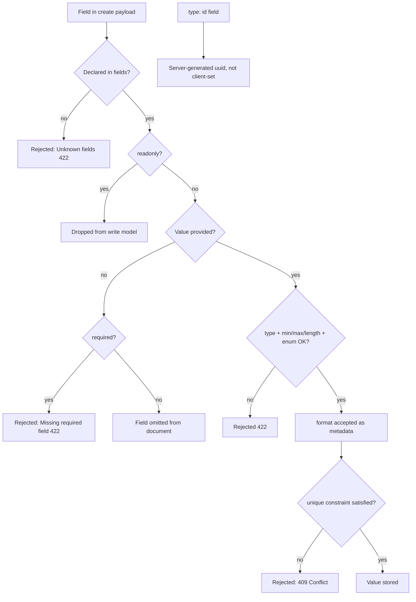

Declares the type and constraints for each field in an entity's `fields:` map.

## Syntax

All fields are declared under `fields:` in an entity definition. Each field must specify a `type`.

```yaml
fields:
  fieldName:
    type: <id | string | number | boolean | datetime | enum | array | object | ref>
    required: <boolean>
    readonly: <boolean>
    default: <value>
```

Field names must start with a letter and contain only letters, numbers, or underscores; anything else fails with `INVALID_FIELD_NAME`.

## Enforced vs metadata-only

Not every option you can declare is checked at runtime. Keep this distinction in mind:

- **Enforced on write** (HTTP 422 on violation): `type`, `required`, `min`, `max`, `minLength`, `maxLength`, enum membership, and ISO-8601 parsing for `datetime`.
- **Datastore-enforced** (`409 Conflict` on collision): `unique` creates a SQL
  unique constraint or MongoDB unique partial index.
- **Metadata only** (declared but NOT enforced): `format` (email/uri/e164) is a
  documentation/OpenAPI hint and does not reject a request.

## Common Options

These options apply to all field types.

| Option | Required | Type | Default | Description |
|--------|----------|------|---------|-------------|
| `required` | no | boolean | `false` | If `true`, the field must be present in create/replace payloads (omitting it returns 422). Relaxed for `update` (PATCH), where every field is optional. |
| `readonly` | no | boolean | `false` | If `true`, the field is dropped from all write payloads (create, update, replace). Use it for server-managed fields. |
| `default` | no | any | none | Baked into the create/replace Pydantic model. See the note below: an omitted field is NOT persisted with its default. |

### How `default` actually behaves

The generated FastAPI backend builds your request body with `payload.model_dump(exclude_unset=True)` before inserting. So a `default:` you declare is present on the model, but if the client omits the field, it is stripped from the document and never written. The default surfaces only if you want a value echoed when constructing the model directly; it does not act as a server-side fill-in on create.

The `stackform run` dev server does no default-filling at all and treats `required` strictly, so behavior matches: omit a field and it stays absent.

### How `readonly` behaves

A `readonly: true` field is excluded from the create, update, and replace request models. Clients cannot set it. It still appears in responses if your code or another path writes it (for example an external-auth provider). This is how a spec marks server-managed fields like `externalSubject`, `lastLoginAt`, and `isActive`.

## `type: id`

UUID primary key. Exactly one `type: id` field is required per entity unless you declare a natural key with `pk:` (see [Primary keys](./primary-keys.md)).

```yaml
id: { type: id }                   # uuidv7 (default)
id: { type: id, format: uuidv7 }   # explicit uuidv7
id: { type: id, format: uuidv4 }   # explicit uuidv4
```

| Option | Required | Type | Default | Description |
|--------|----------|------|---------|-------------|
| `format` | no | `"uuidv7"` or `"uuidv4"` | `"uuidv7"` | UUID generation strategy. |

### Behavior

- **Parse time:** If the entity declares no `type: id` field and no `pk:`, generation fails with `ID_FIELD_MISSING`. There is no implicit `id` injection.
- **Compile time:** The `id` field is excluded from all write request models (create, update, replace).
- **Runtime:** The server generates the value on create and returns it in all responses. `uuidv7` uses the stdlib `uuid.uuid7` where available and falls back to the `uuid_utils` package; `uuidv4` uses the stdlib.

## `type: string`

UTF-8 text value.

```yaml
name: { type: string }
email: { type: string, required: true, format: email }
bio: { type: string, default: "" }
```

| Option | Required | Type | Default | Description |
|--------|----------|------|---------|-------------|
| `format` | no | `"email"`, `"e164"`, `"uri"` | none | Documentation/OpenAPI hint only. NOT validated at runtime. |
| `minLength` | no | integer | none | Minimum character count (enforced, 422 on violation). |
| `maxLength` | no | integer | none | Maximum character count (enforced, 422 on violation). |

## `type: number`

Integer or floating-point number.

```yaml
age: { type: number }
price: { type: number, required: true }
viewCount: { type: number, default: 0 }
```

| Option | Required | Type | Default | Description |
|--------|----------|------|---------|-------------|
| `min` | no | number | none | Minimum value, inclusive (enforced, 422 on violation). |
| `max` | no | number | none | Maximum value, inclusive (enforced, 422 on violation). |

## `type: boolean`

True or false.

```yaml
active: { type: boolean, default: true }
published: { type: boolean, default: false }
```

No type-specific options.

## `type: datetime`

ISO 8601 timestamp. Stored and returned as a string.

```yaml
createdAt: { type: datetime, readonly: true }
expiresAt: { type: datetime, required: true }
```

Clients send and receive RFC 3339 strings (for example `"2024-01-15T10:00:00Z"`). The value is validated by parsing with `datetime.fromisoformat`; a string that does not parse is rejected with 422. The value itself is persisted as the ISO string, not converted to a BSON Date.

No type-specific options.

## `type: enum`

One of a fixed set of string values.

```yaml
status:
  type: enum
  values: [draft, published, archived]
  default: draft
```

| Option | Required | Type | Default | Description |
|--------|----------|------|---------|-------------|
| `values` | yes | list of strings | -- | The allowed values. Must be non-empty (`values` is required for enum fields). |
| `default` | no | string | none | A value to bake into the model. Not range-checked against `values` at parse time. |

A create or update payload sending a value outside `values` is rejected with HTTP 422.

## `type: array`

A list of items.

```yaml
tags:
  type: array
  items:
    type: string

scores:
  type: array
  items:
    type: number
```

| Option | Required | Type | Default | Description |
|--------|----------|------|---------|-------------|
| `items` | yes | field config | -- | Schema for array elements. `items.type` may be any scalar type; only the element type is applied. |

## `type: object`

A free-form JSON object. No nested schema validation is performed on its contents.

```yaml
metadata: { type: object }
settings: { type: object }
```

No type-specific options.

## `type: ref`

A reference to another entity. Stores a plain string id; there is no foreign-key integrity.

```yaml
ownerId: { type: ref, ref: user }
myRefField: { type: ref, ref: myOtherEntity, required: true }
```

| Option | Required | Type | Default | Description |
|--------|----------|------|---------|-------------|
| `ref` | yes | string (entity name) | -- | Names the target entity. Used by the UI generator to resolve relations; see Behavior. |

### Behavior

- **Type:** A `ref` field is generated as a plain `str` and validated only as a string. There is no UUID-format check on the value.
- **Parse time:** For ordinary `ref` fields the target name is NOT validated. Pointing `ref:` at a non-existent or abstract entity does not fail generation. Only `ui.collections` from-path traversal validates ref targets, and only repository `entity:` bindings reject abstract entities (`DESUGAR_ABSTRACT_REFERENCED`).
- **Runtime:** The stored value is the raw id string. No automatic join is performed; relations are dereferenced only by the UI layer or your own queries.

## Examples

### Entity with all field types

```yaml
api:
  basePath: /api
  version: v1

entities:
  myEntity:
    fields:
      id: { type: id }
      title: { type: string, required: true }
      body: { type: string }
      viewCount: { type: number, default: 0 }
      pinned: { type: boolean, default: false }
      status:
        type: enum
        values: [draft, published, archived]
        default: draft
      publishedAt: { type: datetime }
      createdAt: { type: datetime, readonly: true }
      tags:
        type: array
        items:
          type: string
      metadata: { type: object }
      ownerId: { type: ref, ref: user }
```

With this `api:` block a create is `POST /api/v1/my-collection` (the route base is the repository name; see [Entities overview](./overview.md)).

### `required: true` alongside `default:`

```yaml
status:
  type: enum
  values: [draft, published]
  default: draft
  required: true
```

Because `required: true`, the field must be sent on create; if it is omitted the request is rejected with 422 (the declared `default` is stripped by `exclude_unset` and does not satisfy the requirement). To make a field optional with a server-side value, write your own logic or a custom handler -- a bare `default:` does not auto-fill on create.

## Field create-request lifecycle

How a single field value flows through a create request:



Two things the diagram makes concrete: a declared `default` is NOT persisted when
the field is omitted, and `format` remains metadata while `unique` is enforced by
the datastore.

## Edge Cases

- **`required: true` with `default:`** -- The field must still be sent on create; the default is stripped before insert and does not satisfy the requirement.

- **`unique: true`** -- Declarative and UI-only. No MongoDB index is created and duplicates are NOT rejected on write. Use it to signal intent to the generated UI, not as a uniqueness guarantee.

- **`format`** -- A documentation/OpenAPI hint. `email`/`uri`/`e164` are never validated by the running app; an invalid email passes.

- **`type: id` -- count rules.** Zero `id` fields and no `pk:` fails with `ID_FIELD_MISSING`. Two or more `id` fields fail with `ID_FIELD_MULTIPLE`. An invalid `format` fails with `ID_FORMAT_INVALID`.

- **`type: id` -- never in payloads.** The `id` field is never accepted in any write body. It is server-generated and returned in responses.

- **`type: ref` -- no referential integrity.** The value is a plain string; MongoDB enforces no foreign keys. Dangling references are possible.

- **`type: ref` -- target not validated.** An unknown or abstract entity name in `ref:` does not fail generation for a plain field.

- **`type: enum` -- invalid payload value.** A value outside `values` is rejected with HTTP 422.

- **`type: object` / `type: array`** -- Stored as-is. Objects get no nested schema validation; arrays validate only that the value is a list.

## Errors

| Condition | Error code | Message |
|-----------|-----------|---------|
| Field name not matching `[a-zA-Z][a-zA-Z0-9_]*` | `INVALID_FIELD_NAME` | "Invalid field name '<name>'" |
| No `type: id` field and no `pk:` | `ID_FIELD_MISSING` | "Entity must define exactly one field with type 'id'" |
| Two or more `type: id` fields on one entity | `ID_FIELD_MULTIPLE` | "Entity must define exactly one field with type 'id'" |
| `type: id` with invalid `format` | `ID_FORMAT_INVALID` | "id field format must be uuidv7 or uuidv4" |
| `pk:` naming a field not in the entity | `PK_FIELD_NOT_FOUND` | "pk field '<name>' not found in entity '<entity>'" |

## See Also

- [Entities overview](./overview.md)
- [Primary keys](./primary-keys.md)
- [Entity inheritance](./inheritance.md)
