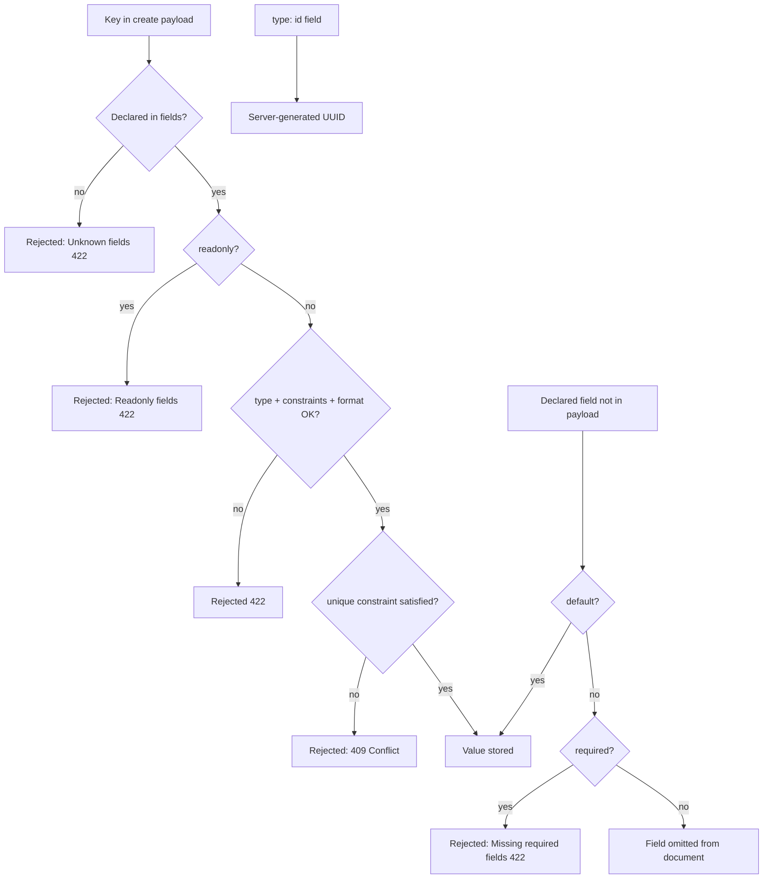

Declares the type and constraints for each field in an entity's `fields:` map.

## Syntax

All fields are declared under `fields:` in an entity definition. Each field must specify a `type`.

```yaml
fields:
  fieldName:
    type: <id | string | number | boolean | datetime | enum | array | object | ref>
    required: <boolean>
    readonly: <boolean>
    default: <value>
    unique: <boolean>
```

Field names must start with a letter and contain only letters, numbers, or underscores; anything else fails with `INVALID_FIELD_NAME`.

## Enforcement

The generated FastAPI, DRF and raw backends and the `stackform run` dev server check a
request body the same way:

- **On write** (HTTP 422 on violation): `type`, `required`, `readonly`, `min`, `max`,
  `minLength`, `maxLength`, `format`, enum membership, ISO 8601 parsing for
  `datetime`, the `items` of an array, and the `properties` of an object. A key the
  entity does not declare is rejected.
- **In the datastore** (409 Conflict on collision): `unique` creates a SQL unique
  constraint or a MongoDB unique index.

## Common Options

These options apply to all field types.

| Option | Required | Type | Default | Description |
|--------|----------|------|---------|-------------|
| `required` | no | boolean | `false` | The field must be present in create and replace payloads unless it has a `default`. On update (PATCH) every field is optional. A required field may not be `null`. |
| `readonly` | no | boolean | `false` | Clients may not send the field; a write body that carries it gets 422. Its `default`, if any, is still stored on create. |
| `default` | no | any | none | Stored on create and replace when the payload omits the field. Checked against the field's own constraints at parse time (`FIELD_CONSTRAINT_INVALID`). |
| `unique` | no | boolean | `false` | No two records may hold the same value (409 on collision). |

A field that is neither required nor given a default may be omitted or sent as `null`.

## `type: id`

UUID primary key. Exactly one `type: id` field is required per entity unless you declare a natural key with `pk:` (see [Primary keys](./primary-keys.md)).

```yaml
id: { type: id }                   # uuidv7 (default)
id: { type: id, format: uuidv7 }   # explicit uuidv7
id: { type: id, format: uuidv4 }   # explicit uuidv4
```

| Option | Required | Type | Default | Description |
|--------|----------|------|---------|-------------|
| `format` | no | `"uuidv7"` or `"uuidv4"` | `"uuidv7"` | UUID generation strategy. |

### Behavior

- **Parse time:** If the entity declares no `type: id` field and no `pk:`, generation fails with `ID_FIELD_MISSING`. There is no implicit `id` injection.
- **Write:** The `id` field is never accepted in a write body.
- **Runtime:** The server generates the value on create and returns it in all responses.

## `type: string`

UTF-8 text value.

```yaml
name: { type: string }
email: { type: string, required: true, format: email }
bio: { type: string, default: "" }
```

| Option | Required | Type | Default | Description |
|--------|----------|------|---------|-------------|
| `format` | no | `"email"`, `"e164"`, `"uri"`, `"uuidv4"`, `"uuidv7"` | none | The value must have this format (422 otherwise). |
| `minLength` | no | integer | none | Minimum character count (422 on violation). |
| `maxLength` | no | integer | none | Maximum character count (422 on violation). |

## `type: number`

Integer or floating-point number. A boolean is not a number.

```yaml
age: { type: number }
price: { type: number, required: true }
viewCount: { type: number, default: 0 }
```

| Option | Required | Type | Default | Description |
|--------|----------|------|---------|-------------|
| `min` | no | number | none | Minimum value, inclusive (422 on violation). |
| `max` | no | number | none | Maximum value, inclusive (422 on violation). |

## `type: boolean`

True or false.

```yaml
active: { type: boolean, default: true }
published: { type: boolean, default: false }
```

No type-specific options.

## `type: datetime`

ISO 8601 timestamp. Stored and returned as a string.

```yaml
createdAt: { type: datetime, readonly: true }
expiresAt: { type: datetime, required: true }
```

Clients send ISO 8601 strings (for example `"2024-01-15T10:00:00Z"`). A string that does
not parse is rejected with 422. The value is stored as a UTC ISO 8601 string; a value
without an offset is taken as UTC.

No type-specific options.

## `type: enum`

One of a fixed set of values.

```yaml
status:
  type: enum
  values: [draft, published, archived]
  default: draft
```

| Option | Required | Type | Default | Description |
|--------|----------|------|---------|-------------|
| `values` | yes | non-empty list | -- | The allowed values. |

A `default` outside `values` fails generation with `FIELD_CONSTRAINT_INVALID`. A
payload value outside `values` is rejected with 422.

## `type: array`

A list of items.

```yaml
tags:
  type: array
  items:
    type: string

scores:
  type: array
  items:
    type: number
    min: 0
```

| Option | Required | Type | Default | Description |
|--------|----------|------|---------|-------------|
| `items` | yes | field config | -- | Config every element must satisfy, with its own type and constraints. |

## `type: object`

A JSON object.

```yaml
metadata: { type: object }
address:
  type: object
  properties:
    street: { type: string, required: true }
    zip: { type: string, maxLength: 10 }
```

| Option | Required | Type | Default | Description |
|--------|----------|------|---------|-------------|
| `properties` | no | map of field configs | none | The object's keys, each checked like a top-level field. |
| `additionalProperties` | no | boolean | `false` with `properties`, else `true` | Whether keys outside `properties` are accepted. |

## `type: ref`

A reference to another entity. Stores a plain string id; there is no foreign-key integrity.

```yaml
ownerId: { type: ref, ref: user }
myRefField: { type: ref, ref: myOtherEntity, required: true }
```

| Option | Required | Type | Default | Description |
|--------|----------|------|---------|-------------|
| `ref` | yes | string (entity name) | -- | Names the target entity. |

### Behavior

- **Parse time:** `ref` must name a declared entity, abstract or not
  (`REF_TARGET_NOT_FOUND`), at any nesting depth.
- **Runtime:** The value is checked as a string and stored as the raw id. No join is
  performed and a dangling reference is not rejected.

## Examples

### Entity with all field types

```yaml
version: "0.2"

api:
  basePath: /api
  version: v1

entities:
  user:
    fields:
      id: { type: id }
  myEntity:
    fields:
      id: { type: id }
      title: { type: string, required: true }
      body: { type: string }
      viewCount: { type: number, default: 0 }
      pinned: { type: boolean, default: false }
      status:
        type: enum
        values: [draft, published, archived]
        default: draft
      publishedAt: { type: datetime }
      createdAt: { type: datetime, readonly: true }
      tags:
        type: array
        items:
          type: string
      metadata: { type: object }
      ownerId: { type: ref, ref: user }

repositories:
  myCollection:
    entity: myEntity
```

With this `api:` block a create is `POST /api/v1/my-collection` (the route base is the repository name; see [Entities overview](./overview.md)).

### `required: true` alongside `default:`

```yaml
status:
  type: enum
  values: [draft, published]
  default: draft
  required: true
```

A create that omits `status` stores `draft`. A create that sends `status: null` is
rejected with 422.

## Field create-request lifecycle

How a single field value flows through a create request:



## Edge Cases

- **`type: id` -- count rules.** Zero `id` fields and no `pk:` fails with `ID_FIELD_MISSING`. Two or more `id` fields fail with `ID_FIELD_MULTIPLE`. A `format` other than `uuidv7` or `uuidv4` fails with `SCHEMA_VALIDATION_ERROR`.

- **`type: ref` -- no referential integrity.** The datastore enforces no foreign keys. Dangling references are possible.

- **Update (PATCH).** Every field is optional and no default is filled in; the fields sent are checked as on create.

## Errors

| Condition | Error code | Message |
|-----------|-----------|---------|
| Field name not matching `[a-zA-Z][a-zA-Z0-9_]*` | `INVALID_FIELD_NAME` | "Invalid field name '<name>'" |
| No `type: id` field and no `pk:` | `ID_FIELD_MISSING` | "Entity must define exactly one field with type 'id'" |
| Two or more `type: id` fields on one entity | `ID_FIELD_MULTIPLE` | "Entity must define exactly one field with type 'id'" |
| A `default` that breaks the field's own constraints | `FIELD_CONSTRAINT_INVALID` | "default '<value>' is invalid: ..." |
| `ref:` naming an undeclared entity | `REF_TARGET_NOT_FOUND` | "Field references undeclared record type '<name>'" |
| `pk:` naming a field not in the entity | `PK_FIELD_NOT_FOUND` | "pk field '<name>' not found in entity '<entity>'" |
| An unknown option, or an option of the wrong shape | `SCHEMA_VALIDATION_ERROR` | |

## See Also

- [Entities overview](./overview.md)
- [Primary keys](./primary-keys.md)
- [Entity inheritance](./inheritance.md)
