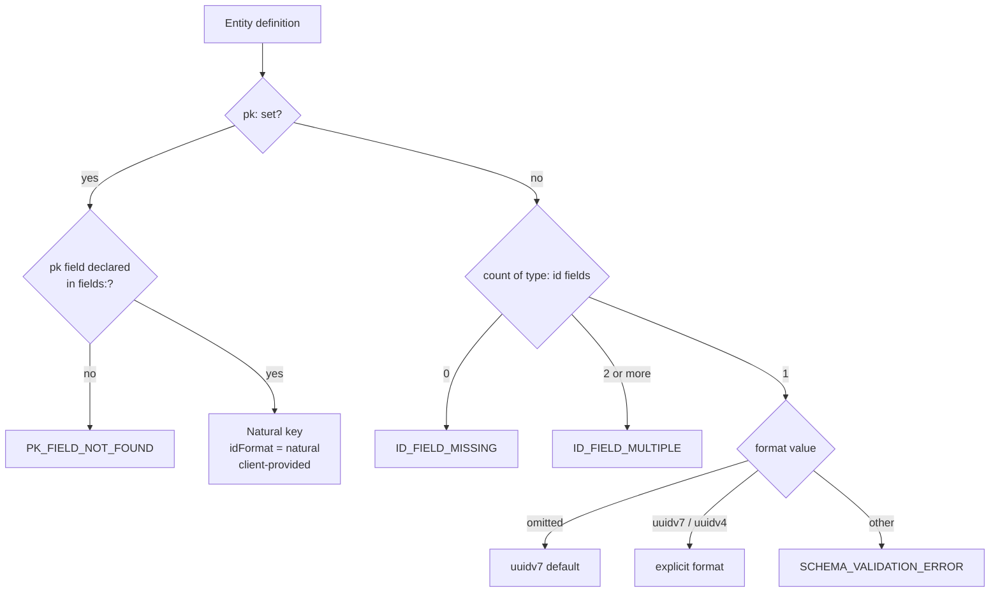

Controls how entities are uniquely identified -- either via a server-generated UUID (`type: id`) or a client-provided natural key (`pk:`).

All example URLs below assume this `api:` block:

```yaml
api:
  basePath: /api
  version: v1
```

That produces routes under `/api/v1/...`. Omitting `version` drops the version segment (routes become `/api/...`).

## Syntax

### Server-generated UUID (default)

```yaml
fields:
  id: { type: id }                   # uuidv7 (default)
  id: { type: id, format: uuidv7 }   # explicit uuidv7
  id: { type: id, format: uuidv4 }   # explicit uuidv4
```

### Natural key

```yaml
entities:
  myEntity:
    pk: myField
    fields:
      myField: { type: string }
      name: { type: string, required: true }
repositories:
  myCollection:
    entity: myEntity
```

## Resolution



## Behavior

### `type: id`

- **Build time:** The `id` field is excluded from every request model (create, update, replace). It is never accepted in request bodies.
- **Runtime:** The server generates the UUID on create. The value is returned in all responses and used as the document identifier in the URL path parameter, which is always literal `{id}` (for example `GET /api/v1/my-collection/{id}`).
- **Lookup:** A path lookup matches the value against the entity's id field. The `stackform run` dev server additionally tries the MongoDB `_id` (as a string or `ObjectId`), so a record can be fetched by either its id field or its raw `_id`.

### `pk: fieldName`

- **Build time:** The parser checks that the named field exists in `fields:`. No `type: id` field is required or added; the collection's id format is set to `natural`. Because the pk field is an ordinary field (not `type: id`), it stays in the create model -- the client must supply it.
- **Runtime:** No value is generated. The pk field value the client provides is stored as-is and used as the document identifier in the URL path. The path parameter is still literal `{id}`, but it matches against your pk field, so `POST /api/v1/my-collection` with `{"code": "US", ...}` is later fetched at `GET /api/v1/my-collection/US`.

## Options

### UUID formats

| Format | Description |
|--------|-------------|
| `uuidv7` | Time-ordered UUID. Monotonically increasing; good for index locality. Default. Requires a runtime that provides `uuid.uuid7` (Python 3.13+) or the `uuid_utils` package; otherwise create fails at runtime. |
| `uuidv4` | Random UUID. No ordering guarantee. |

### Natural key

| Property | Required | Type | Description |
|----------|----------|------|-------------|
| `pk` | no | string (field name) | The field to use as the primary key. Must exist in `fields:`. |

## Examples

### Surrogate key (default)

```yaml
api:
  basePath: /api
  version: v1
entities:
  myEntity:
    fields:
      id: { type: id }
      title: { type: string, required: true }
repositories:
  myCollection:
    entity: myEntity
```

Creating a record (the `id` is generated server-side, never sent):

```bash
curl -X POST http://localhost:8000/api/v1/my-collection -d '{"title": "Hello"}'
# Returns: {"id": "019...", "title": "Hello"}
# Then: GET http://localhost:8000/api/v1/my-collection/019...
```

### Natural key

```yaml
api:
  basePath: /api
  version: v1
entities:
  myEntity:
    pk: code
    fields:
      code: { type: string }
      name: { type: string, required: true }
repositories:
  myCollection:
    entity: myEntity
```

Creating a record (the client supplies `code`):

```bash
curl -X POST http://localhost:8000/api/v1/my-collection \
  -d '{"code": "US", "name": "Example"}'
# Then: GET http://localhost:8000/api/v1/my-collection/US
```

## Comparison

| | `type: id` | `pk: fieldName` |
|---|---|---|
| Value source | Server-generated | Client-provided |
| Format | UUID (v7 or v4) | Any field type (prefer string) |
| In create body | excluded | included (client must send it) |
| Path param | `{id}`, matches the id field | `{id}`, matches your pk field |
| Index / uniqueness | none | none (see Edge Cases) |
| Use case | Surrogate keys | Natural / business keys |

## Edge Cases

- **`pk: fieldName` -- field must exist.** The field referenced by `pk:` must be declared in `fields:`. If not, the parser raises `PK_FIELD_NOT_FOUND` ("pk field 'X' not found in entity 'Y'").

- **`pk:` with a `type: id` field present.** When `pk:` is set, the id-field detection is skipped entirely -- the `type: id` field (if any) is never processed for primary-key purposes, and no UUID is generated. Do not declare both; use one or the other.

- **Natural keys are NOT generated.** The client must provide the pk value on every create. Omitting a `required` pk field is a validation error; a pk field without `required: true` is simply optional in the request model.

- **Natural keys should be string-typed.** Path parameters arrive as strings and are matched against the stored value as a string. A `number`-typed pk stored as a number will not match the string path segment, so a natural pk should be `type: string`.

- **No uniqueness enforcement.** There is no MongoDB unique index on the id or pk field. Sending a `pk` value that already exists inserts a second document with the same key rather than returning a 409; subsequent lookups by that value return whichever document MongoDB finds first. Enforce uniqueness in your own data-loading or seeding logic if you need it.

- **Two `type: id` fields.** If an entity (with no `pk:`) declares two or more `type: id` fields, the parser raises `ID_FIELD_MULTIPLE`.

- **No id and no pk.** An entity with no `pk:` and no `type: id` field raises `ID_FIELD_MISSING`. There is no implicit `id` injection -- you must declare exactly one `type: id` field or set `pk:`.

## Errors

| Condition | Error code | Message |
|-----------|-----------|---------|
| `pk:` references a non-existent field | `PK_FIELD_NOT_FOUND` | "pk field 'X' not found in entity 'Y'" |
| No `type: id` field and no `pk:` | `ID_FIELD_MISSING` | "Entity must define exactly one field with type 'id'" |
| Two or more `type: id` fields | `ID_FIELD_MULTIPLE` | "Entity must define exactly one field with type 'id'" |
| Invalid `format` on `type: id` | `SCHEMA_VALIDATION_ERROR` | "'<format>' is not one of ['uuidv7', 'uuidv4']" |

## See Also

- [Field types](./field-types.md)
- [Entities overview](./overview.md)
