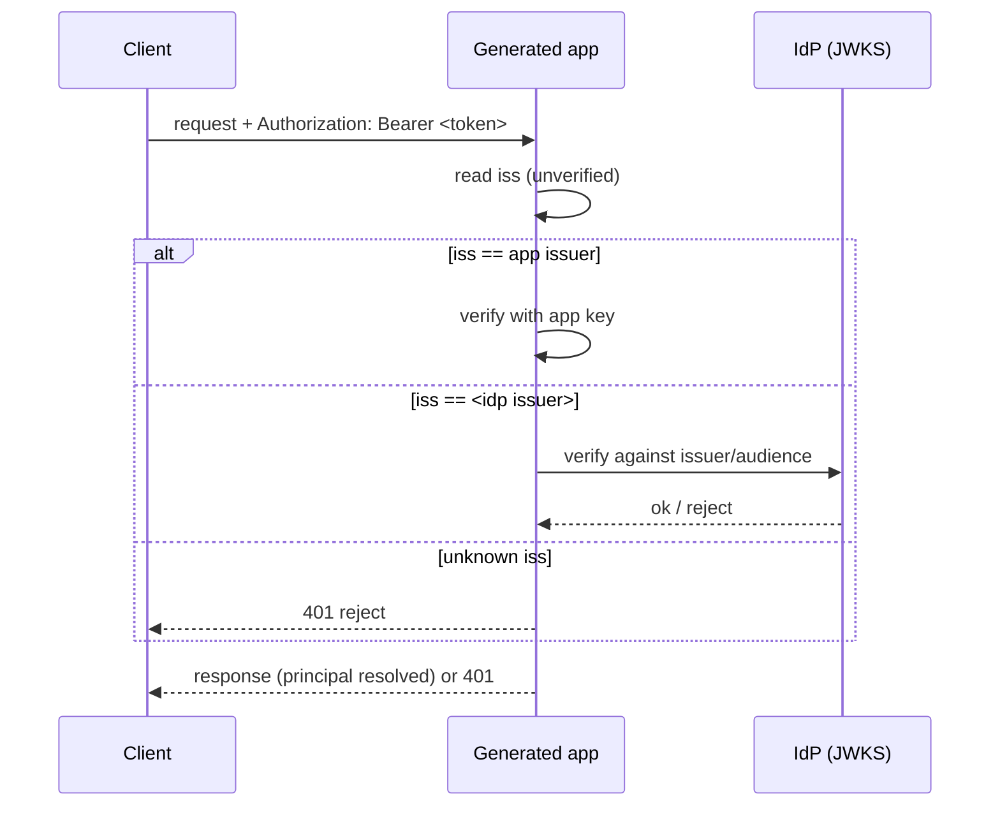

The top-level `providers:` section declares external identity providers (OIDC and
SAML). A declared provider does nothing on its own: it becomes active once an auth
entity names it in `auth.via`. The built-in `password` and `apiKey` providers are
not declared here; `auth.via` names them directly.

## Structure

```yaml
providers:
  myoidc:
    type: oidc
    client_id: my-app
    client_secret: ${OIDC_CLIENT_SECRET}
    discovery_url: ${OIDC_DISCOVERY_URL}
  mysaml:
    type: saml
    idp_metadata_url: ${SAML_METADATA_URL}
    sp_entity_id: ${APP_URL}
```

Each key under `providers:` is the provider name. An auth entity signs users in
through it by naming it in `auth.via`:

```yaml
entities:
  user:
    type: auth
    auth:
      identifier: email
      via:
        - provider: password
        - provider: myoidc
          claim_mapping:
            name: name
          auto_provision: true
    fields:
      id: { type: id }
      email: { type: string, required: true, unique: true }
      name: { type: string }
```

`auth.via` takes a provider name, a list of names, or a list of binding objects.
A name (`via: [password, myoidc]`) uses the entity's `auth.identifier` and the
binding defaults. A binding object carries the provider name plus its own
`identifier`, `claim_mapping`, `auto_provision` (default `true`) and `relations`.
See [Claim mapping](../auth/claim-mapping.md) for the binding fields and
[Login, SSO, and the token flow](../auth/login-and-sso.md) for the runtime flow.

A `via` entry naming neither a built-in provider nor a key of `providers` is
rejected with `AUTH_VIA_UNKNOWN_PROVIDER`.

## Provider types

| Type | Description |
|------|-------------|
| `oidc` | OpenID Connect. The backend reads the provider's `discovery_url` to find the authorization, token, userinfo and JWKS endpoints. |
| `saml` | SAML 2.0 service provider. The backend fetches the IdP metadata at request time. |

## Token trust

An OIDC provider's `trust` decides who verifies its tokens on each request:

| `trust` | Meaning |
|---------|---------|
| `app` (default) | The IdP is used only during login. The app then mints its own session token, and the client carries that token. |
| `idp` | The client keeps carrying the **IdP's** access token and the app verifies it against the IdP on every call, issuing no session of its own. |

A SAML provider always signs users in through the app.

When both an app-trust login and an `idp` provider exist, the generated auth
dependency dispatches strictly on the bearer token's `iss` claim: the app issuer
is verified with the app's own key, each IdP issuer against that IdP, and anything
else is rejected (no "try every verifier"):



## Fields per type

Each provider config is closed: only the fields below are accepted, and any other
key fails with `SCHEMA_VALIDATION_ERROR`.

### OIDC

| Field | Required | Description |
|-------|----------|-------------|
| `type` | yes | Must be `oidc`. |
| `trust` | no | `app` (default) or `idp`. |
| `client_id` | yes | OAuth client identifier issued by the IdP (e.g. "Client ID" in Google console, "Application (client) ID" in Azure). |
| `discovery_url` | yes | OpenID configuration URL (`.../.well-known/openid-configuration`); used to resolve endpoints, JWKS keys and the expected token issuer. |
| `client_secret` | no, `trust: app` only | OAuth client secret. Omit it for a public client. For a confidential client the generated backend reads it at run time from the `<PROVIDER>_CLIENT_SECRET` env var, seeded with the spec value. |
| `issuer` | no, `trust: idp` only | Override for the expected token `iss`; read from the discovery document by default. |
| `audiences` | no, `trust: idp` only | The accepted token `aud` values. Defaults to `[client_id]`, and generation then warns with `TRUST_IDP_AUDIENCE_DEFAULTED`. For Keycloak, see [Keycloak: putting the API in `aud`](./oidc.md#keycloak-putting-the-api-in-aud). |

`client_secret` under `trust: idp`, and `issuer` or `audiences` under
`trust: app`, fail with `SCHEMA_VALIDATION_ERROR`.

There is no built-in discovery for any provider name. Names such as `google`,
`microsoft`, or `apple` are not special; supply `discovery_url` for every OIDC
provider.

### SAML

| Field | Required | Description |
|-------|----------|-------------|
| `type` | yes | Must be `saml`. |
| `idp_metadata_url` | yes | IdP metadata URL (fetched at request time). |
| `sp_entity_id` | yes | This service provider's entity ID. |

## Environment interpolation

Any value may use `${VAR}` interpolation, resolved at build time before schema
validation. A `${VAR:-default}` form supplies a fallback when the variable is
unset:

```yaml
providers:
  myoidc:
    type: oidc
    client_id: my-app
    client_secret: ${OIDC_CLIENT_SECRET}
    discovery_url: ${OIDC_DISCOVERY_URL:-https://idp.example.com/realms/my-realm/.well-known/openid-configuration}
```

A referenced variable that has no value and no default aborts generation with
`INTERPOLATION_MISSING_VAR`. Keep the literal client secret out of the spec file;
the deployed backend reads it from its own `<PROVIDER>_CLIENT_SECRET` env var.
See [Environment variables](../configuration/environment-variables.md).

## Routes a provider adds

Once an auth entity signs users in through a provider, the backend exposes these
routes under the entity's collection (the full path is
`{api.basePath}[/{api.version}]/{collection}/...`). With
`api: { basePath: /api, version: v1 }` and a `users` collection:

| Method and path | Purpose |
|-----------------|---------|
| `GET /api/v1/users/auth/providers` | Lists the external providers of this collection (consumed by the generated login page). |
| `GET /api/v1/users/auth/myoidc` | Starts the OIDC login: 302 redirect to the IdP. |
| `GET /api/v1/users/auth/myoidc/callback` | Completes the OIDC exchange: maps claims, finds or provisions the user, mints a one-time login code, and redirects to `{FRONTEND_URL}/auth/callback?code=<code>`. |
| `GET /api/v1/users/auth/myoidc/logout` | RP-initiated logout: redirects to the provider's `end_session_endpoint`. |
| `GET /api/v1/users/auth/mysaml` | Starts the SAML login: redirect to the IdP. |
| `POST /api/v1/users/auth/mysaml/callback` | SAML Assertion Consumer Service: validates the response, then 303-redirects to `{FRONTEND_URL}/auth/callback?code=<code>`. |
| `GET /api/v1/users/auth/mysaml/metadata` | SP metadata XML. |
| `GET /api/v1/users/auth/mysaml/logout` | Redirects to the IdP's single logout service. |
| `POST /api/v1/auth/exchange` | Redeems the one-time login code (`{"code": "..."}`) for the app JWT (`{"token": "<jwt>"}`). |

A `trust: idp` OIDC provider adds only the logout route, since it signs no one in
through the app. A declared provider that no entity names emits nothing.

The `stackform run` development server and the generated FastAPI backend serve
these routes. The `drf` and `raw` targets and `stackform run --raw` reject a
provider that signs users in through the app with `BACKEND_FEATURE_UNSUPPORTED`.

### Logout

Clearing the app JWT only ends the *app* session; the IdP keeps its own SSO cookie,
so the next login is silent. The logout route ends the IdP session: the generated
frontend's logout clears the token and, for an SSO session, navigates to
`/{collection}/auth/{provider}/logout`, which redirects to the IdP. Because the app
mints its own token and does not retain the IdP `id_token`, OIDC logout is requested
with `client_id` + `post_logout_redirect_uri` (supported by Keycloak 18+) rather
than `id_token_hint`.

## See also

- [OIDC provider](./oidc.md) -- OIDC config and callback flow in detail.
- [SAML provider](./saml.md) -- SAML config and the ACS callback.
- [Claim mapping](../auth/claim-mapping.md) -- binding fields and auto-provisioning.
- [Login, SSO, and the token flow](../auth/login-and-sso.md) -- the full lifecycle.
