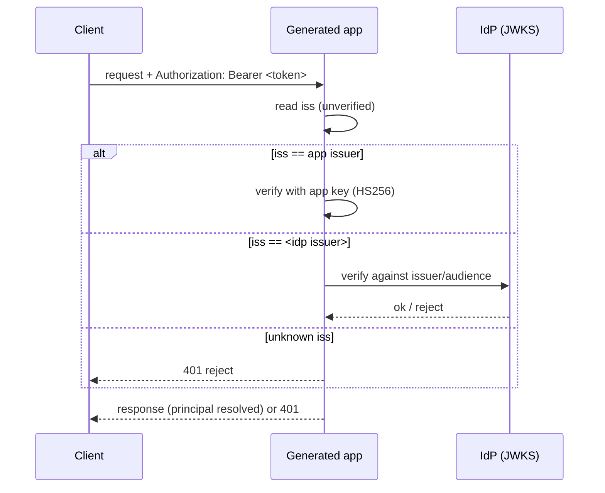

The top-level `providers:` section declares external identity providers (OIDC and
SAML) that auth entities can attach to. A declared provider does nothing on its own:
it becomes active only once an auth entity references it from `auth.bindings`. The
built-in `password` and `apiKey` providers are not declared here; they are selected
with `auth.via`.

## Structure

```yaml
providers:
  myoidc:
    type: oidc
    client_id: my-app
    client_secret: ${OIDC_CLIENT_SECRET}
    discovery_url: ${OIDC_DISCOVERY_URL}
  mysaml:
    type: saml
    idp_metadata_url: ${SAML_METADATA_URL}
    sp_entity_id: ${APP_URL}
```

Each key under `providers:` is the provider name. That name is what an auth entity
references in a binding:

```yaml
entities:
  user:
    type: auth
    auth:
      identifier: email
      via: password           # built-in providers go in `via`
      bindings:               # external providers attach here
        - provider: myoidc   # references providers.myoidc
          identifier: email
```

`auth.via` selects built-in providers (`password`, `apiKey`). External OIDC/SAML
providers attach through `auth.bindings`, where each entry carries the provider
name plus its own `identifier`, optional `claim_mapping`, and `auto_provision`
(defaults to true). See [Claim mapping](../auth/claim-mapping.md) for the binding
fields and [Login, SSO, and the token flow](../auth/login-and-sso.md) for the
runtime flow.

## Provider types

| Type | Description |
|------|-------------|
| `oidc` | OpenID Connect. The backend reads the provider's `discovery_url` at request time to find the authorization, token, and userinfo endpoints. |
| `saml` | SAML 2.0 service provider. The backend fetches the IdP metadata at request time. |

## Token trust

A provider's `trust` decides who verifies its tokens on each request:

| `trust` | Meaning |
|---------|---------|
| `app` (default) | After login the app mints and verifies its **own** session token. The IdP is used only during login; from then on the client carries the app's JWT. This is the current end-to-end behavior. |
| `idp` | The client keeps carrying the **IdP's** token and the app verifies it against the IdP on every call, issuing no session of its own. Requires `issuer` and `audience` to verify against. |

`trust: idp` is only valid for `oidc`/`saml` providers, and rejects the
app-signing fields (`algorithm`, `secret`, `ttl`, `refresh`, `delivery`) that only
make sense under `app` trust. A `trust: idp` provider that omits `issuer` or
`audience` fails validation.

When both an `app` provider and an `idp` provider exist, the generated auth
dependency dispatches strictly on the bearer token's `iss` claim -- the app
issuer is verified with the app's own key, each IdP issuer against that IdP, and
anything else is rejected (no "try every verifier"):



> **Status:** `trust: idp` is parsed and validated, but the per-call dispatch
> above is not yet generated -- the IdP-verify branch is a planned seam. Use
> `trust: app` (the default) for a working runtime; `idp` verification lands with
> resource-server support.

## Required fields per type

Each provider config is closed (`additionalProperties: false`): only the fields
below are accepted, and unknown keys fail schema validation. Which fields are
required depends on `trust`.

### OIDC

| Field | Required | Description |
|-------|----------|-------------|
| `type` | yes | Must be `oidc`. |
| `trust` | no | `app` (default) or `idp`. |
| `client_id` | yes | OAuth client identifier issued by the IdP. |
| `client_secret` | yes under `trust: app` | OAuth client secret. |
| `discovery_url` | yes under `trust: app` | OpenID configuration URL (`.../.well-known/openid-configuration`); the backend reads it to resolve endpoints. |
| `issuer` | yes under `trust: idp` | Expected `iss` of the IdP's tokens. |
| `audience` | yes under `trust: idp` | Expected `aud` of the IdP's tokens. |

There is no built-in discovery for any provider name. Names such as `google`,
`microsoft`, or `apple` are not special; you must supply `discovery_url` for every
`trust: app` OIDC provider.

### SAML

| Field | Required | Description |
|-------|----------|-------------|
| `type` | yes | Must be `saml`. |
| `trust` | no | `app` (default) or `idp`. |
| `idp_metadata_url` | yes under `trust: app` | IdP metadata URL (fetched at request time). |
| `sp_entity_id` | yes under `trust: app` | This service provider's entity ID. |
| `issuer` | yes under `trust: idp` | Expected `iss` of the IdP's tokens. |
| `audience` | yes under `trust: idp` | Expected `aud` of the IdP's tokens. |

## Environment interpolation

Any value may use `${VAR}` interpolation, resolved before schema validation. This
keeps secrets out of the spec. A `${VAR:-default}` form supplies a fallback when
the variable is unset:

```yaml
providers:
  myoidc:
    type: oidc
    client_id: my-app
    client_secret: ${OIDC_CLIENT_SECRET}
    discovery_url: ${OIDC_DISCOVERY_URL:-https://idp.example.com/realms/my-realm/.well-known/openid-configuration}
```

A referenced variable that has no value and no default aborts generation. See
[Environment variables](../configuration/environment-variables.md).

## Routes a bound provider adds

Once an auth entity binds an OIDC provider, the generated backend exposes these
routes under the entity's collection (the full path is
`{api.basePath}[/{api.version}]/{collection}/...`). With
`api: { basePath: /api, version: v1 }` and a `users` collection bound to a
`myoidc` provider:

| Method and path | Purpose |
|-----------------|---------|
| `GET /api/v1/users/auth/providers` | Lists the external providers bound to this collection (consumed by the generated login page). |
| `GET /api/v1/users/auth/myoidc` | Starts the login: 302 redirect to the IdP. |
| `GET /api/v1/users/auth/myoidc/callback` | Completes the IdP exchange: maps claims, finds or provisions the user, mints a one-time login code, and redirects to `{FRONTEND_URL}/auth/callback?code=<code>`. |
| `POST /api/v1/auth/exchange` | Redeems the one-time login code (`{"code": "..."}`) for the app JWT (`{"token": "<jwt>"}`). Emitted once whenever any collection binds an OIDC provider. |

These routes exist only when an entity actually binds the provider; a declared but
unbound provider emits nothing.

## See also

- [OIDC provider](./oidc.md) -- OIDC config and callback flow in detail.
- [SAML provider](./saml.md) -- SAML config and the ACS callback.
- [Claim mapping](../auth/claim-mapping.md) -- binding fields and auto-provisioning.
- [Login, SSO, and the token flow](../auth/login-and-sso.md) -- the full lifecycle.
