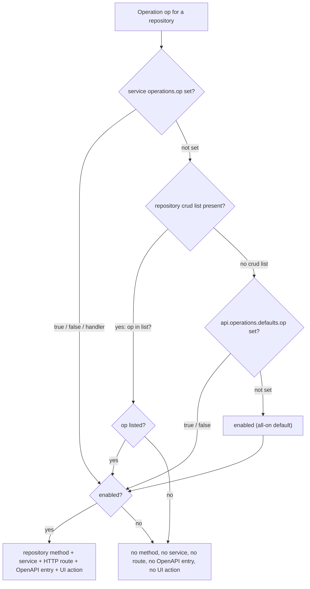

The six CRUD operations (`list`, `get`, `create`, `update`, `replace`, `delete`) are not
a fixed bundle. Each one is an independent unit, and a repository chooses exactly which
ones it exposes. That single choice flows end to end: an operation you leave out produces
no repository method, no service, no HTTP route, no OpenAPI entry, and no button in the
generated UI.

## Core premise

A repository selects its operation subset with a `crud:` list:

```yaml
repositories:
  myCollection:
    entity: myEntity
    crud: [list, get, create, update, delete]
```

Listing `crud:` is opt-out, not opt-in: you write the operations you want to keep, and
everything you omit is removed.

## Default: all six enabled

When you omit `crud:` entirely, the repository enables all six operations:

```yaml
repositories:
  myCollection:
    entity: myEntity
    # no crud: -> list, get, create, update, replace, delete
```

`replace` (PUT) is on by default just like the others. To disable it, either drop it from
a `crud:` list or turn it off globally under `api.operations.defaults` (see below).

## Resolution precedence

For each operation, the effective enabled/disabled state is resolved from four layers,
highest priority first:

1. Service `operations.<op>` override (per service group).
2. Repository `crud` list (the operation is enabled only if it appears in the list).
3. `api.operations.defaults.<op>` (global default flags).
4. All-enabled fallback (every operation defaults to on).



For example, `api.operations.defaults` is the place to disable an operation across every
repository at once:

```yaml
api:
  basePath: /api
  version: v1
  operations:
    defaults:
      replace: false   # no repository gets PUT unless it re-enables replace
```

A repository's `crud:` list overrides that default, and a service-level
`operations.<op>` override beats both.

## End-to-end consequence

Because the operation set is resolved once and reused, an omitted operation disappears
everywhere. A read-only repository is just a short list:

```yaml
repositories:
  myCollection:
    entity: myEntity
    crud: [list, get]
```

That `myCollection` repository has no create/update/replace/delete method, the service group
exposes only `list` and `get`, only `GET /api/v1/my-collection` and `GET /api/v1/my-collection/{id}`
routes are generated, and the generated UI shows no New, Edit, or Delete affordances.

## Worked example

A resource that can be created, browsed, and removed, but never edited:

```yaml
api:
  basePath: /api
  version: v1

repositories:
  myCollection:
    entity: myEntity
    crud: [create, list, get, delete]
```

With `update` left out:

- No repository update method and no `update-my-collection` service is generated.
- No `PATCH /api/v1/my-collection/{id}` route appears in the API or its OpenAPI schema.
- The generated UI renders no Edit button on the detail page.

The remaining operations behave normally: `POST /api/v1/my-collection`,
`GET /api/v1/my-collection`, `GET /api/v1/my-collection/{id}`, and
`DELETE /api/v1/my-collection/{id}`.

## Errors

| Code | Cause |
|------|-------|
| `CRUD_OPERATION_INVALID` | A `crud:` entry is not one of `list`, `get`, `create`, `update`, `replace`, `delete`. |
| `CRUD_WITHOUT_ENTITY` | A repository declares `crud:` but no `entity:`. |
| `REPOSITORY_EMPTY` | A repository has neither an `entity:` nor any custom `operations:`. |

## See also

- [Repository Operations](operations.md) for custom `query`/`handler` operations.
- [Controller Operations](../controllers/operations.md) for how the resolved set becomes HTTP routes.
