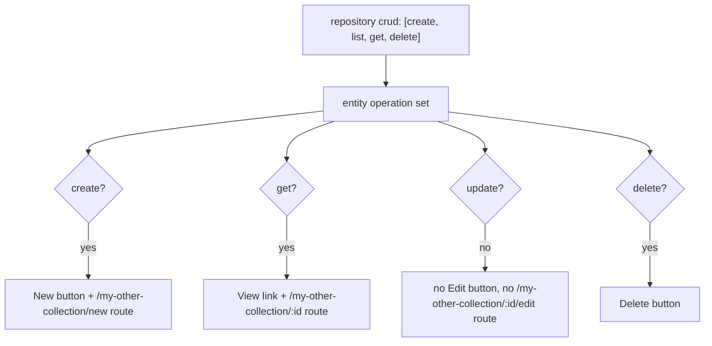

The generated React app never shows an action the backend cannot serve. Every
button (New, View, Edit, Delete) and every client-side route (`/new`, `/:id`,
`/:id/edit`) is gated on the CRUD operations that the backing repository's
`crud` set exposes. Disable an operation in your spec and its UI affordance
disappears along with its HTTP route. This is the frontend half of
[composable per-operation CRUD](../repositories/composable-crud).

## Where the operation set comes from

Each entity rendered in the UI carries the exact set of CRUD operations its
repository exposes. That set is derived from the routes the generator emits,
which in turn come from the repository's `crud` list (default: all six of
`list`, `get`, `create`, `update`, `replace`, `delete`). Drop an operation from
`crud` and it is absent from the repository, the service, the HTTP route, and
the UI.

```yaml
api:
  basePath: /api
  version: v1

repositories:
  myCollection:
    entity: myEntity
    crud: [create, list, get, update, delete]
  myOtherCollection:
    entity: myOtherEntity
    crud: [create, list, get, delete]   # no update -> no Edit anywhere
```

With this spec, `myCollection` renders the full action set; `myOtherCollection`
renders everything except Edit, because `update` is not in its `crud` list.

## Per-surface gating

The pack gates actions on the surface where they live. The mapping from CRUD
operation to UI affordance is:

| Operation | Surface | Affordance gated on it |
|-----------|---------|------------------------|
| `create`  | List page | "New" button (and the empty-state "Create your first record" button) |
| `get`     | List page | "View" link on each row |
| `update`  | Detail page | "Edit" button |
| `delete`  | Detail page | "Delete" button |

If an operation is not in the entity's set, its button or link is simply not
emitted into the generated `.tsx` page.

## Route gating

A `crud` view generates three page files (the list, a form, and a detail page)
and registers up to four routes. The list route is always present; the other
three are gated identically to the buttons that navigate to them:

| Route | Renders | Gated on |
|-------|---------|----------|
| `/my-collection`          | List page   | always (the view's `path`) |
| `/my-collection/new`      | Form (create) | `create` |
| `/my-collection/:id`      | Detail page | `get` |
| `/my-collection/:id/edit` | Form (edit) | `update` |

Because the route is omitted, navigating to it directly resolves to nothing.
There is no Edit button to reach `/my-collection/:id/edit`, and the route itself
is not registered.

The `crud` composite component wires all of this for you:

```yaml
ui:
  frontend:
    pack: generic
  config:
    app_name: My App
  views:
    myCollection:
      path: /my-collection
      component: crud
      props:
        entity: myEntity
    myOtherCollection:
      path: /my-other-collection
      component: crud
      props:
        entity: myOtherEntity
```

For `myOtherCollection` (no `update`), the generated app omits the Edit button
on the detail page and never registers `/my-other-collection/:id/edit`. Create,
View, and Delete all remain because `create`, `get`, and `delete` are in its
`crud` list.



## Login gate

When the spec declares any `type: auth` entity, the app wraps every route in an
authentication gate. The gate is controlled by `ui.config.require_auth`, which
defaults to `true`:

```yaml
ui:
  config:
    require_auth: true   # default; set false to leave the app open
```

With the gate on, an unauthenticated visitor is shown the login page and only
sees the app shell once a token is stored. The generated app exposes a
`useAuth()` hook (`token`, `user`, `login`, `logout`); the sidebar shows a
Logout action when signed in and a Login link otherwise.

External identity providers bound to the auth entity are surfaced as SSO
buttons on the login page. The app fetches the provider list from
`GET {basePath}[/{version}]/{collection}/auth/providers` and renders a
"Continue with ..." button for each, redirecting to
`{basePath}[/{version}]/{collection}/auth/{provider}` to start the flow. See
[Login, SSO, and the token flow](../auth/login-and-sso) for the backend side.

## See also

- [Composable per-operation CRUD](../repositories/composable-crud) - the
  backend mechanism this gating mirrors.
- [UI Views](views) - how a `crud` view expands into pages and routes.
- [Authentication required by default](../auth/auth-required-by-default) - how
  routes are protected once an auth entity exists.
