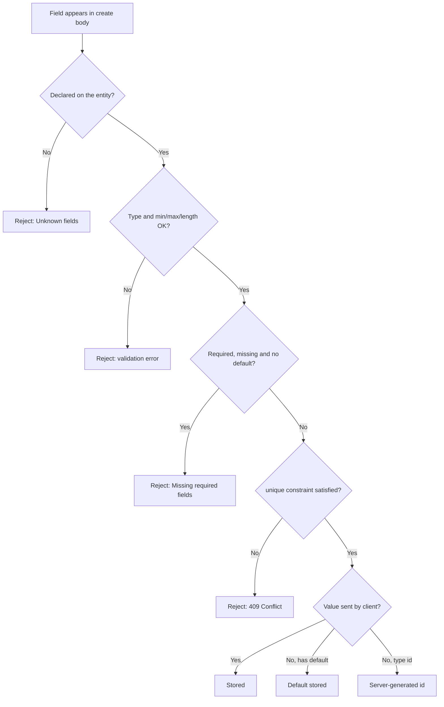

**Concept introduced:** every field type and the difference between constraints that are enforced and options that are metadata-only.

## Adding a richer entity

Extend the note entity from tutorial 01 to demonstrate every field type. The `api:`
block below fixes the URL prefix so the curl commands later in this page are
reproducible exactly as written.

```yaml
version: "0.2"

api:
  basePath: /api
  version: v1

mongo:
  uri: mongodb://localhost:27017
  database: myapp

entities:
  note:
    fields:
      id: { type: id }
      title: { type: string, required: true, minLength: 1, maxLength: 200 }
      body: { type: string }
      viewCount: { type: number, default: 0, min: 0 }
      pinned: { type: boolean, default: false }
      status:
        type: enum
        values: [draft, published, archived]
        default: draft
      publishedAt: { type: datetime }
      createdAt: { type: datetime, readonly: true }
      tags:
        type: array
        items:
          type: string
      metadata:
        type: object

repositories:
  notes:
    entity: note

services:
  notes: {}

controllers:
  notes:
    service: notes
    base_path: /notes
    access: public
```

With `basePath: /api` and `version: v1`, the notes routes live under
`/api/v1/notes`.

## Field type reference

| Type | Description | Extra options |
|------|-------------|---------------|
| `id` | Server-generated identifier, implicitly the primary key | `format: uuidv7` (default) or `format: uuidv4` |
| `string` | UTF-8 text | `required`, `unique`, `default`, `readonly`, `minLength`, `maxLength`, `format` |
| `number` | Integer or float | `required`, `default`, `readonly`, `min`, `max` |
| `boolean` | True/false | `default`, `readonly` |
| `datetime` | ISO 8601 timestamp string | `required`, `default`, `readonly` |
| `enum` | One of a fixed set of values | `values: [...]` required; `default` optional |
| `array` | List of items | `items:` sub-schema (required) |
| `object` | Free-form JSON object | `properties:` (optional typed shape), `additionalProperties` |
| `ref` | String id pointing at another entity | `ref: entityName` required |

## Common field options

- `required: true` -- field must be present on create (and on replace). On update,
  every field is optional.
- `default: value` -- stored on create and replace when the client omits the
  field. A required field with a default may be omitted.
- `readonly: true` -- clients may not send the field; a write body that carries it
  is rejected with 422. Its default, if any, is still stored on create. Good for
  audit columns like `createdAt`.
- `unique: true` -- creates a SQL unique constraint or MongoDB unique partial
  index. A duplicate write is rejected with `409 Conflict`; the response names
  the field when the datastore supplies it without exposing the conflicting value.

## Validation constraints

These constraints ARE enforced on write (a violating request is rejected before the
document is stored):

| Option | Applies to | Effect |
|--------|------------|--------|
| `min` | `number` | value must be `>= min` |
| `max` | `number` | value must be `<= max` |
| `minLength` | `string` (and `ref`) | string length must be `>= minLength` |
| `maxLength` | `string` (and `ref`) | string length must be `<= maxLength` |
| `values` | `enum` | value must be one of the listed values |
| `format` | `string` | value must be a valid `email`, `uri`, `e164`, `uuidv4` or `uuidv7` |

The lifecycle below shows where a single field value is checked during a create
request:



## The id field

Every entity needs exactly one `type: id` field (or a `pk:` natural key, see below).
Declaring none raises `ID_FIELD_MISSING`; declaring two raises `ID_FIELD_MULTIPLE`.
The id is generated server-side, so clients never send it. The default format is
`uuidv7`; set `format: uuidv4` to switch. `id` fields are excluded from every write
model.

## References

A `ref` field stores a plain string id that names a document in another
entity/repository:

```yaml
authorId: { type: ref, ref: author, required: true }
```

The value is stored and validated as a string, with no foreign-key integrity. The
target must be a declared entity; a typo in `ref:` fails generation with
`REF_TARGET_NOT_FOUND`. Relationships are covered in tutorial 03.

## Typed objects and arrays

`object` accepts free-form JSON by default. To check an inner shape, add
`properties:` (each value is itself a field config); keys outside `properties` are
then rejected unless `additionalProperties: true`. `array` requires an `items:`
sub-schema that every element must satisfy; the item can be any field type,
including an `object`:

```yaml
metadata:
  type: object
  properties:
    source: { type: string }
    importedAt: { type: datetime }
attachments:
  type: array
  items:
    type: object
    properties:
      url: { type: string }
      size: { type: number }
```

## Natural primary keys

Instead of a generated `id`, an entity can use one of its own fields as the primary
key with `pk:`:

```yaml
country:
  pk: code
  fields:
    code: { type: string, required: true }
    name: { type: string, required: true }
```

The named field must exist (`PK_FIELD_NOT_FOUND` otherwise). With a natural key the
client supplies the key on create, and there is no uniqueness enforcement, so do not
declare both a `pk:` and a `type: id` field. Natural keys are detailed in the
primary-keys reference.

## Create a note with all fields

```bash
curl -X POST http://127.0.0.1:8000/api/v1/notes \
  -H 'Content-Type: application/json' \
  -d '{
    "title": "My note",
    "body": "Content here",
    "viewCount": 0,
    "pinned": true,
    "status": "published",
    "publishedAt": "2024-01-15T10:00:00Z",
    "tags": ["tech", "api"],
    "metadata": {"source": "import"}
  }'
```

The `id` field is always omitted -- it is generated server-side. `createdAt` is
`readonly`, so it is rejected if you send it. Fields with defaults (`viewCount`,
`pinned`, `status`) may be omitted, but remember that an omitted field is not
persisted at all: if you want the default `0`/`false`/`draft` stored on the document,
send it explicitly as shown above.
