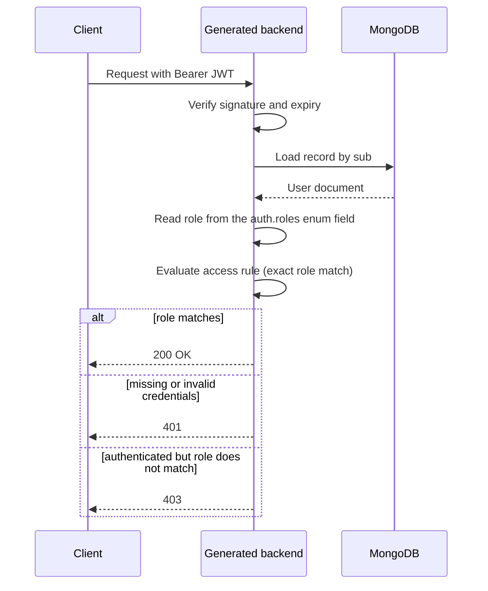

**Concept introduced:** Declaring roles on an auth entity with an enum field and using them in role-based access rules.

## Declaring roles

Roles are not a standalone block. A role is an ordinary `enum` field on the auth
entity, and you point `auth.roles` at that field's name. The field's `values` list
defines the valid roles and its `default` decides the role a new record gets.

```yaml
version: "0.2"

api:
  basePath: /api
  version: v1
  operations:
    auth:
      register: true
      login: true

mongo:
  uri: mongodb://localhost:27017
  database: myapp

entities:
  user:
    type: auth
    auth:
      identifier: email
      via: password
      roles: role
    fields:
      id: { type: id }
      email: { type: string, required: true, unique: true }
      displayName: { type: string, required: true }
      role:
        type: enum
        values: [admin, moderator, user]
        default: user

  note:
    fields:
      id: { type: id }
      title: { type: string, required: true }
      body: { type: string }

repositories:
  users:
    entity: user
  notes:
    entity: note

services:
  users: {}
  notes: {}

controllers:
  users:
    service: users
    base_path: /users
    access: "*"
    operations:
      register: { access: public }
      login: { access: public }
      list: { access: user:admin }
      delete: { access: user:admin }

  notes:
    service: notes
    base_path: /notes
    access: public
    operations:
      create: { access: "*" }
      update: { access: user:moderator }
      delete: { access: user:moderator }
```

With this `api:` block the user routes are:

- `POST /api/v1/users/register` (public)
- `POST /api/v1/users/login` (public)
- `GET /api/v1/users` (requires the `admin` role)
- `DELETE /api/v1/users/{id}` (requires the `admin` role)

The `role` field must be of type `enum`, and its name must match `auth.roles`.
A mismatch fails generation with `AUTH_ROLES_FIELD_NOT_FOUND`; pointing `auth.roles`
at a non-enum field fails with `AUTH_ROLES_FIELD_NOT_ENUM`.

> **Enforcement status**
>
> Roles (exact match), `<entity>:*` scoping, and ownership/ABAC `when` rules
> are enforced by the generated FastAPI backend, the generated DRF backend, and the
> `yaml-api run` dev server alike. A request that fails a rule gets 401 (missing or
> invalid credentials), 403 (authenticated but not allowed), or 404 (record not
> found, checked before ownership). Two current limitations: role hierarchy (for
> example `admin` inheriting `moderator`) is accepted in YAML but not yet applied
> during enforcement -- only exact role matches are checked; and conditional or
> ownership rules require a v0.2 spec, because v0.1 specs do not parse `when` rules.

## How a role reaches an access decision

The JWT carries only identity (`sub` and `identity_collection`). On every request
the backend loads the record from MongoDB and reads the role from the enum field you
named in `auth.roles`. So a role change in the database takes effect on the next
request, with no re-login.



## Using a role in an access rule

The access value `entity:role` requires a principal of that entity holding that exact
role. In the example, `access: user:moderator` allows any `user` whose `role` is
`moderator`.

```yaml
operations:
  update: { access: user:moderator }
```

Other access values you can combine with roles:

- `public` -- no authentication.
- `"*"` -- any authenticated principal, role ignored.
- `user:*` -- any `user`, role ignored.
- `user:admin` -- a `user` whose role is exactly `admin`.

### Single auth entity: prefix is optional

When there is only one auth entity you may drop the entity prefix in a role rule:

```yaml
access: moderator       # same as user:moderator when user is the only auth entity
access: admin           # same as user:admin
```

With more than one auth entity the prefix is required. A bare role such as
`access: admin` then fails generation with `ACCESS_AMBIGUOUS_ROLE`, because the engine
cannot tell which entity's `admin` you mean; write `user:admin` (or `apiClient:admin`)
to disambiguate. Using a bare role when there is no auth entity at all fails with
`ACCESS_NO_AUTH_ENTITY`.

## Role hierarchy is not applied yet

You may see a top-level `roles:` map (keyed by auth-entity name) that declares a
hierarchy. It is accepted by the parser but **not applied during enforcement** in any
target today: only exact role matches are checked. An `admin` user does NOT
automatically satisfy `access: user:moderator`. Do not rely on inheritance.

```yaml
# Parsed, but inert during access enforcement today.
roles:
  user:
    admin: [moderator]
    moderator: [user]
```

If you need "admin OR owner" style logic, express it with an access rule list and a
`when` ownership condition rather than a hierarchy. See Tutorial 07 (ABAC rules).

## Setting and changing a role

A new record gets the role from the enum field's `default:` on register. There is no
built-in endpoint dedicated to changing a role: to promote a user, update the `role`
field on the record (through an `update`/`replace` route you have authorized, or
directly in MongoDB).

**Watch out:** the role field is a normal field on the document. In the generated
FastAPI backend it is accepted on write and returned in responses, so anyone allowed
to update a user could set their own role unless you gate the write. Restrict the
`update`/`replace` operations (for example `access: user:admin`) on the users
controller if self-service role changes are a concern.

## Key points

- A role is an `enum` field; `auth.roles` names that field. There is no standalone
  `roles:` block on the entity (any such block is ignored).
- The enum `values` define valid roles; the enum `default` sets the role on register.
- Roles are loaded from the database on every request, so role changes apply
  immediately without re-login.
- Use roles in access rules as `entity:role` (or a bare role when there is one auth
  entity); `entity:*` matches the entity regardless of role.
- Role hierarchy is parsed but inert; only exact role matches are enforced today.
- Roles are per-entity: different auth entities can define completely different role
  sets, each in its own enum field.
