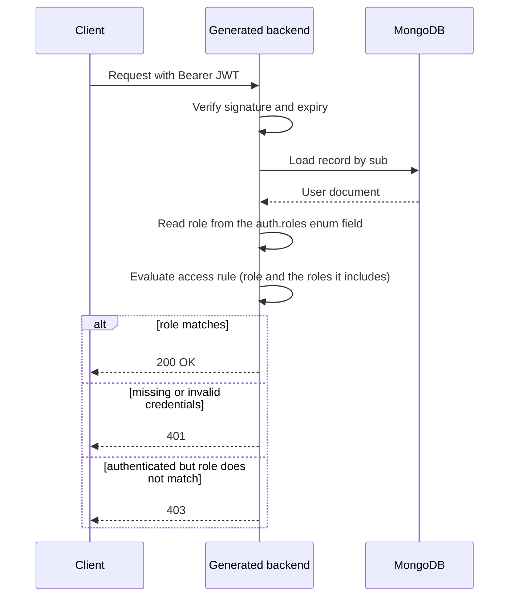

**Concept introduced:** Declaring roles on an auth entity with an enum field and using them in role-based access rules.

## Declaring roles

Here a role is an ordinary `enum` field on the auth entity, and you point
`auth.roles` at that field's name. The field's `values` list defines the valid roles
and its `default` decides the role a new record gets. An auth entity may instead keep
its roles out of its fields with a managed `roles:` block; see
[Roles](../Reference/roles/overview.md).

```yaml
version: "0.2"

api:
  basePath: /api
  version: v1
  operations:
    auth:
      register: true
      login: true

mongo:
  uri: mongodb://localhost:27017
  database: myapp

entities:
  user:
    type: auth
    auth:
      identifier: email
      via: password
      roles: role
    fields:
      id: { type: id }
      email: { type: string, required: true, unique: true }
      displayName: { type: string, required: true }
      role:
        type: enum
        values: [admin, moderator, user]
        default: user

  note:
    fields:
      id: { type: id }
      title: { type: string, required: true }
      body: { type: string }

repositories:
  users:
    entity: user
  notes:
    entity: note

services:
  users: {}
  notes: {}

controllers:
  users:
    service: users
    base_path: /users
    access: "*"
    operations:
      register: { access: public }
      login: { access: public }
      list: { access: user:admin }
      delete: { access: user:admin }

  notes:
    service: notes
    base_path: /notes
    access: public
    operations:
      create: { access: "*" }
      update: { access: user:moderator }
      delete: { access: user:moderator }
```

With this `api:` block the user routes are:

- `POST /api/v1/users/register` (public)
- `POST /api/v1/users/login` (public)
- `GET /api/v1/users` (requires the `admin` role)
- `DELETE /api/v1/users/{id}` (requires the `admin` role)

The `role` field must be of type `enum`, and its name must match `auth.roles`.
A mismatch fails generation with `AUTH_ROLES_FIELD_NOT_FOUND`; pointing `auth.roles`
at a non-enum field fails with `AUTH_ROLES_FIELD_NOT_ENUM`.

> **Enforcement**
>
> Roles, role hierarchies, `<entity>:*` scoping, and ownership/ABAC `when` rules
> are enforced by the generated FastAPI backend, the generated DRF backend, and the
> `stackform run` dev server alike. A request that no rule admits gets 401 when it
> carries no valid credentials and 403 otherwise; a missing record answers 404
> before ownership is checked.

## How a role reaches an access decision

The JWT carries only identity (`sub` and `identity_collection`). On every request
the backend loads the record from MongoDB and reads the role from the enum field you
named in `auth.roles`. So a role change in the database takes effect on the next
request, with no re-login.



## Using a role in an access rule

The access value `entity:role` requires a principal of that entity holding that
role. In the example, `access: user:moderator` allows any `user` whose `role` is
`moderator`.

```yaml
operations:
  update: { access: user:moderator }
```

Other access values you can combine with roles:

- `public` -- no authentication.
- `"*"` -- any authenticated principal, role ignored.
- `user:*` -- any `user`, role ignored.
- `user:admin` -- a `user` holding `admin`, directly or through the hierarchy.

### Single auth entity: prefix is optional

When there is only one auth entity you may drop the entity prefix in a role rule:

```yaml
access: moderator       # same as user:moderator when user is the only auth entity
access: admin           # same as user:admin
```

With more than one auth entity the prefix is required. A bare role such as
`access: admin` then fails generation with `ACCESS_AMBIGUOUS_ROLE`, because the engine
cannot tell which entity's `admin` you mean; write `user:admin` (or `apiClient:admin`)
to disambiguate. Using a bare role when there is no auth entity at all fails with
`ACCESS_NO_AUTH_ENTITY`.

## Role hierarchy

A `roles:` block on the auth entity can declare which roles include others. Repeat
the enum's values and default there, then add the `hierarchy`:

```yaml
entities:
  user:
    type: auth
    auth:
      identifier: email
      via: password
      roles: role
    roles:
      values: [admin, moderator, user]
      default: user
      hierarchy:
        admin: [moderator]
        moderator: [user]
```

An `admin` now satisfies `access: user:moderator` and `access: user:user`, so each rule
names the lowest role allowed. See [Role hierarchy](../Reference/roles/hierarchy.md).

For "admin OR owner" style logic, combine a role rule with a `when` ownership
condition in an access rule list. See Tutorial 07 (ABAC rules).

## Setting and changing a role

A new record gets the role from the enum field's `default:` on register. To promote
a user, update the `role` field through an `update`/`replace` route, or directly in
MongoDB.

A caller sets the role field only to a role it holds itself, counting the roles its
hierarchy includes. A create that names a role the caller does not hold stores the
default role instead, and an update that does so leaves the role unchanged. So a
public `register` always yields `user`, and only an `admin` can make another user an
`admin`.

## Key points

- A role is an `enum` field named by `auth.roles`, or a managed role declared in a
  `roles:` block.
- The enum `values` define valid roles; the enum `default` sets the role on register.
- A caller grants only roles it holds.
- Roles are loaded from the database on every request, so role changes apply
  immediately without re-login.
- Use roles in access rules as `entity:role` (or a bare role when there is one auth
  entity); `entity:*` matches the entity regardless of role.
- `roles.hierarchy` lets a role include others, so a higher role passes every rule
  for the roles it includes.
- Roles are per-entity: different auth entities can define completely different role
  sets, each in its own enum field.
