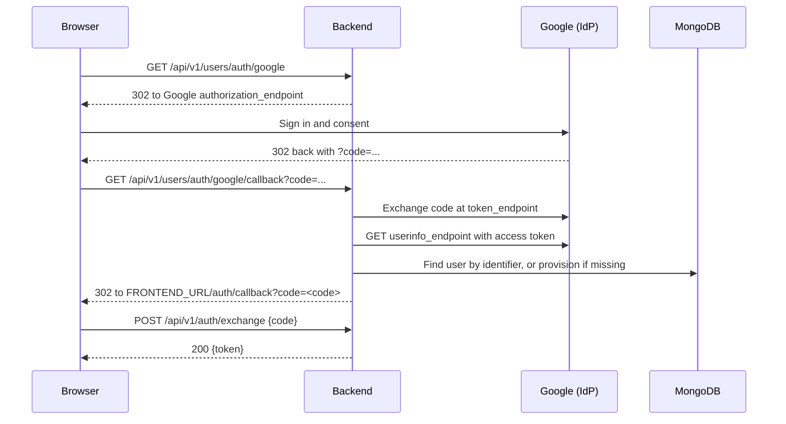

**Concept introduced:** Adding an external OIDC provider alongside password login via `auth.bindings`.

Password login is configured through `auth.via`. External identity providers (OIDC,
SAML) are configured separately: declare the provider once under the top-level
`providers:` block, then attach it to an auth entity through `auth.bindings`. Each
binding generates its own login flow that ends in the same app-issued JWT, so your
access rules work identically no matter how the user signed in.

## Adding Google OIDC to the user entity

```yaml
version: "0.2"

api:
  basePath: /api
  version: v1
  operations:
    auth:
      register: true
      login: true

mongo:
  uri: mongodb://localhost:27017
  database: myapp

providers:
  google:
    type: oidc
    client_id: ${GOOGLE_CLIENT_ID}
    client_secret: ${GOOGLE_CLIENT_SECRET}
    discovery_url: https://accounts.google.com/.well-known/openid-configuration

entities:
  base:
    abstract: true
    fields:
      id: { type: id }
      createdAt: { type: datetime }

  user:
    extends: base
    type: auth
    auth:
      identifier: email
      via: password
      roles: role
      bindings:
        - provider: google
          identifier: email
          claim_mapping:
            email: email
            displayName: name
          auto_provision: true
    fields:
      email: { type: string, required: true, unique: true }
      displayName: { type: string, required: true }
      role:
        type: enum
        values: [admin, moderator, user]
        default: user

  note:
    extends: base
    fields:
      title: { type: string, required: true }
      body: { type: string }
      authorId: { type: ref, ref: user }
      published: { type: boolean, default: false }

repositories:
  users:
    entity: user
  notes:
    entity: note

services:
  users: {}
  notes:
    operations:
      publish: { handler: notes.publish }

controllers:
  users:
    service: users
    base_path: /users
    access: "*"
    operations:
      register: { access: public }
      login: { access: public }

  notes:
    service: notes
    base_path: /notes
    access: "*"
    operations:
      list: { access: public }
      get: { access: public }
      create: { access: "*" }
      update:
        access:
          - moderator
          - given:
              principal: identity:user
              document: notes
            when: principal equals document.authorId
      delete:
        access:
          - moderator
          - given:
              principal: identity:user
              document: notes
            when: principal equals document.authorId
      publish:
        method: POST
        path: "/{id}/publish"
        access:
          - given:
              principal: identity:user
              document: notes
            when: principal equals document.authorId
```

What to notice in this spec:

- `providers.google` defines the OIDC provider. `discovery_url` is required -- the
  generated backend reads the provider's `authorization_endpoint`, `token_endpoint`,
  and `userinfo_endpoint` from that document. There is no built-in discovery for
  "well-known" providers; always supply the URL.
- `auth.via: password` keeps password login. The Google provider is attached through
  `auth.bindings`, NOT through `via`. `via` is only for the built-in `password` and
  `apiKey` methods.
- `claim_mapping` and `auto_provision` live INSIDE each binding, not on the entity.
- Roles come from an enum field named by `auth.roles: role`. A standalone
  entity-level `roles:` block is silently ignored in v0.2; see Tutorial 06.

> **Enforcement status**
>
> Roles (exact match), `<entity>:*` scoping, and ownership/ABAC `when` rules
> are enforced by the generated FastAPI backend, the generated DRF backend, and the
> `yaml-api run` dev server alike. A request that fails a rule gets 401 (missing or
> invalid credentials), 403 (authenticated but not allowed), or 404 (record not
> found, checked before ownership). Two current limitations: role hierarchy (for
> example `admin` inheriting `moderator`) is accepted in YAML but not yet applied
> during enforcement -- only exact role matches are checked; and conditional or
> ownership rules require a v0.2 spec, because v0.1 specs do not parse `when` rules.

## Generated OIDC routes

With `api: { basePath: /api, version: v1 }`, the engine generates these endpoints
automatically for each OIDC binding:

| Method | Path | Description |
|--------|------|-------------|
| GET | /api/v1/users/auth/google | Redirect to Google's authorization endpoint |
| GET | /api/v1/users/auth/google/callback | Handle the OAuth2 `code` callback, issue a JWT, then 302 to the frontend |
| GET | /api/v1/users/auth/providers | List the external providers bound to this entity |

The routes are mounted at `{basePath}[/{version}]/{collection}/auth/...`, where
`{collection}` is the repository name (`users` here). They appear only once an auth
entity binds the provider.

### The login flow



Rather than putting the JWT in the redirect URL, the callback issues a single-use,
short-lived login code and redirects the browser to `{FRONTEND_URL}/auth/callback?code=<code>`.
The SPA then POSTs the code to `/api/v1/auth/exchange` and receives the same app-signed
JWT that password login produces. If `FRONTEND_URL` is unset, the backend's own base URL
is used as the redirect host.

### The provider-listing endpoint

`GET /api/v1/users/auth/providers` returns the external providers bound to the
entity, so a frontend login page can render the right SSO buttons dynamically:

```json
[
  { "name": "google", "type": "oidc" }
]
```

## Provider config options

```yaml
providers:
  google:
    type: oidc
    client_id: ${GOOGLE_CLIENT_ID}
    client_secret: ${GOOGLE_CLIENT_SECRET}
    discovery_url: https://accounts.google.com/.well-known/openid-configuration
```

- `type` and `client_id` are required for an OIDC provider.
- `client_secret` is optional. Omit it for a public client (the token exchange then
  runs without one); supply it for a confidential client.
- `discovery_url` is required for the generated routes to function: it is the
  provider's OpenID Connect discovery document.
- No other keys are accepted (the provider schema is strict). For verifying IdP
  tokens directly without an app session, see
  [Token trust](../Reference/providers/overview.md#token-trust).

Each provider's discovery URL is provider-specific. A few examples:

```yaml
providers:
  google:
    type: oidc
    client_id: ${GOOGLE_CLIENT_ID}
    client_secret: ${GOOGLE_CLIENT_SECRET}
    discovery_url: https://accounts.google.com/.well-known/openid-configuration

  microsoft:
    type: oidc
    client_id: ${MS_CLIENT_ID}
    client_secret: ${MS_CLIENT_SECRET}
    discovery_url: https://login.microsoftonline.com/${MS_TENANT}/v2.0/.well-known/openid-configuration

  myoidc:
    type: oidc
    client_id: ${CLIENT_ID}
    client_secret: ${CLIENT_SECRET}
    discovery_url: https://auth.example.com/.well-known/openid-configuration
```

### GitHub special case

GitHub does not implement OIDC userinfo the standard way. If you name a binding's
provider `github`, the generated callback fetches the profile from
`https://api.github.com/user` instead of the discovery `userinfo_endpoint`. The
provider still uses the OIDC config shape (`type: oidc`, `client_id`,
`client_secret`, `discovery_url`) for the authorization and token endpoints.

## Binding options in the `auth:` block

```yaml
auth:
  identifier: email          # default identifier field for this entity
  via: password              # built-in methods only (password, apiKey)
  roles: role                # enum field that holds the role
  bindings:
    - provider: google       # references providers.google
      identifier: email      # field matched against the mapped claims
      claim_mapping:         # map OIDC claims to entity fields
        email: email         # entity_field: oidc_claim
        displayName: name
      auto_provision: true   # create the user on first login (default true)
```

- `claim_mapping` copies only the listed claims (`entity_field: claim_name`). Claims
  are not auto-mapped by matching names. If a mapped claim is absent in the provider
  response, that field is simply omitted (not set to null).
- If the binding `identifier` field is not produced by the claim mapping, the
  backend falls back to the `email`, `login`, or `sub` claim to populate it.
- `auto_provision` defaults to `true`: the first login creates a user record. Set it
  to `false` to require the user to already exist; an unmatched login then returns
  `403 User not found and auto-provisioning is disabled`.

**Watch out:** With `auto_provision: true`, the provisioned record contains only the
fields your `claim_mapping` produces (plus the identifier fallback). If your entity
marks fields as `required`, make sure the mapping covers them or set sensible
`default:` values, or you may store an incomplete user.

## SAML providers

SAML follows the same binding model. Declare a SAML provider and attach it via
`auth.bindings`:

```yaml
providers:
  corp:
    type: saml
    idp_metadata_url: https://idp.example.com/metadata
    sp_entity_id: https://myapp.example.com/sp

entities:
  user:
    type: auth
    auth:
      identifier: email
      via: password
      bindings:
        - provider: corp
          identifier: email
          claim_mapping:
            email: emailAddress
            displayName: displayName
```

A SAML binding generates `GET /api/v1/users/auth/corp` (login), a
`POST /api/v1/users/auth/corp/callback` assertion-consumer endpoint that returns
`{"token": ..., "user": {...}}` (with `_id`/`_auth` stripped), and a
`GET /api/v1/users/auth/corp/metadata` endpoint serving the service-provider XML.
`auto_provision` defaults to `true` here too; when disabled, an unmatched assertion
returns 403.

## Environment variables

Provider secrets should use `${VAR}` interpolation. Never hardcode credentials in the
spec:

```bash
export GOOGLE_CLIENT_ID=your-client-id
export GOOGLE_CLIENT_SECRET=your-client-secret
export FRONTEND_URL=http://localhost:5173
yaml-api run myapp.yaml
```

`${VAR}` interpolation happens during spec loading; an unset required variable aborts
generation. `FRONTEND_URL` controls where the OIDC callback redirects after a
successful login.

**Note:** Testing OIDC locally requires a real OAuth app registered with the
provider. For Google, create one at
https://console.cloud.google.com/apis/credentials and set the authorized redirect URI
to match the generated callback path. With the `api:` block above and the dev server
on its default address, that is
`http://127.0.0.1:8000/api/v1/users/auth/google/callback`.

## Key points

- The top-level `providers:` section defines external OIDC/SAML providers; each is
  inert until an auth entity binds it through `auth.bindings`.
- `via:` is for the built-in `password` and `apiKey` methods. External providers are
  attached through `auth.bindings`, where `claim_mapping` and `auto_provision` live.
- OIDC providers require `discovery_url`; there is no well-known-provider inference.
- `auto_provision` defaults to `true`; with it disabled an unmatched login returns 403.
- All login methods (password, OIDC, SAML) issue the same app JWT, so access rules
  apply identically downstream. Roles come from the enum field named by `auth.roles`.
