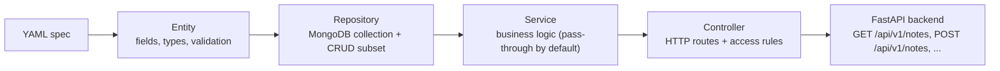
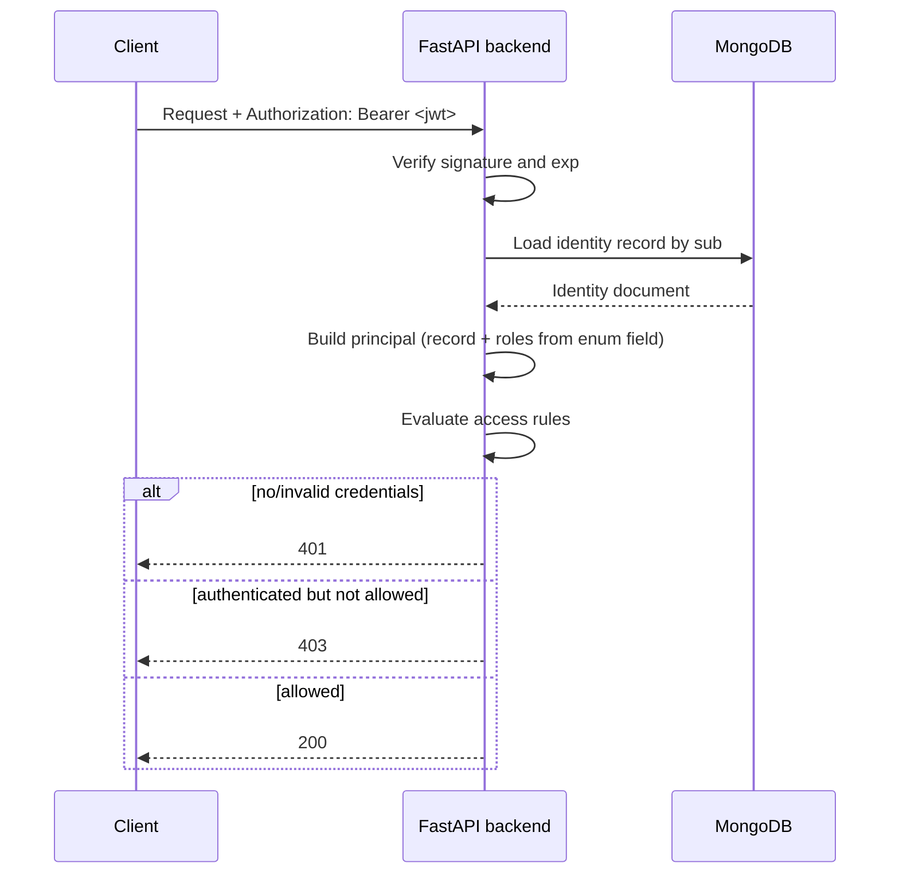

This page explains the architecture of yaml-api-generator for newcomers: the YAML spec, the four layers it describes, how a request is authenticated and authorized, and what the tool generates.

## The YAML spec

Your spec is the single source of truth. Start it with the version selector and an `api:` block:

```yaml
version: "0.2"

api:
  basePath: /api
  version: v1
```

`version: "0.2"` is required to use the v0.2 feature set; omitting it falls back to the older 0.1 dialect. The `api:` block decides the URL prefix: `basePath` defaults to `/api`, and `version` adds a segment only when you set it. With the block above, routes live under `/api/v1/...`; with no `version`, they live under `/api/...`.

From one spec the tool can generate several outputs:

- a backend (FastAPI by default; DRF and raw ASGI are alternative targets),
- a React frontend, when the spec has a `ui:` block,
- deployment artifacts (Docker Compose or systemd), when the spec has a `deploy:` block.

You can also serve the spec directly with `yaml-api run myapp.yaml`, an in-process dev server that needs no code generation.

## The four layers

A spec declares entities, repositories, services, and controllers. Each maps onto a layer of the generated app:



- Entity: what your data looks like. Fields, types, and validation rules. Shared across repositories, services, and controllers.
- Repository: where and how data is stored. Maps an entity to a MongoDB collection (the collection name is the repository name) and selects which CRUD operations exist.
- Service: what operations are available. By default a service passes through to its repository. Custom logic (like a "publish" action) goes here.
- Controller: how operations are exposed over HTTP. Sets the base path, HTTP methods, and access rules. This is where authorization is declared.

## Composable CRUD operations

The six CRUD operations (list, get, create, update, replace, delete) are independent units, not an all-or-nothing bundle. All six are enabled by default. A repository opts out by listing the subset it wants with `crud:`, or you can disable some globally under `api.operations.defaults`:

```yaml
repositories:
  notes:
    entity: note
    crud: [list, get]   # read-only: no create/update/replace/delete
```

An operation that is not selected produces no repository method, no service method, no HTTP route, no OpenAPI entry, and no UI affordance. This is the core premise: each operation is composable, and omitting one removes it end to end.

## Authentication

An identity is any entity declared with `type: auth`. Such an entity names the field used to log in and how credentials are checked:

```yaml
entities:
  user:
    type: auth
    auth:
      identifier: email
      via: password
    fields:
      id: { type: id }
      email: { type: string, required: true }
```

A request can present credentials three ways; they are tried in this order:

1. Bearer JWT in the `Authorization: Bearer <token>` header (issued by login).
2. An API key in the `X-API-Key` header, when the identity declares an `apiKey` field.
3. HTTP Basic credentials in the `Authorization: Basic <...>` header.

The login endpoint (`POST /api/v1/<identity>/login`) returns a signed JWT. The token carries only the subject id (`sub`) and the identity collection name (plus `iat`/`exp`); it does NOT embed roles or the user record. On every request the server loads the identity record from MongoDB by `sub` and rebuilds the principal from it, so role changes take effect immediately.



Roles come from the field named by `auth.roles` (an enum field on the identity entity). The entity-level `roles:` block is accepted in YAML but not wired into enforcement in v0.2; declare roles with `auth.roles: <enumFieldName>` instead.

## Authorization

Controllers declare access with the `access:` keyword, either on the whole controller or per operation. The vocabulary:

- `public`: open, no credentials required (the default for a minified controller, so lock writes down explicitly).
- `"*"`: any valid principal.
- `<entity>:*`: any member of that identity collection.
- `<entity>:<role>`: a principal of that collection holding that exact role.

Ownership and conditional access use `when` rules. Every root the `when` references must be declared in the rule's `given` block (binding either an identity or a document/collection); an undeclared root is a build-time error (`WHEN_UNBOUND_SYMBOL`). `principal` and `document` are conventional names, not built-in roots. Document-bound rules are evaluated after the target record is fetched (a missing record returns 404 before any ownership check). `when` operators are the words `equals`, `not equals`, `and`, `or`, `not`, `in`, and `not in`; operands are field references and single-quoted strings. Stored identity fields are read through `<name>.record.<field>`.

> **Enforcement status**
>
> Roles (exact match), `<entity>:*` scoping, and ownership/ABAC `when` rules
> are enforced by the generated FastAPI backend, the generated DRF backend, and the
> `yaml-api run` dev server alike. A request that fails a rule gets 401 (missing or
> invalid credentials), 403 (authenticated but not allowed), or 404 (record not
> found, checked before ownership). Two current limitations: role hierarchy (for
> example `admin` inheriting `moderator`) is accepted in YAML but not yet applied
> during enforcement -- only exact role matches are checked; and conditional or
> ownership rules require a v0.2 spec, because v0.1 specs do not parse `when` rules.

## Glossary

- Principal: the authenticated identity making a request. Holds the subject id (`sub`), the identity collection name (`identity_collection`), the database record (`record`), and any roles read from the identity's role field (`roles`). In a `when:` rule it is bound under an author-chosen name in `given:` (conventionally `principal`); there is no built-in `principal` root.
- JWT: JSON Web Token. A signed string carrying only `sub` and `identity_collection` (plus `iat`/`exp`); the record and roles are loaded from MongoDB on every request.
- Repository: the data access layer that maps an entity to a MongoDB collection and selects its CRUD operations.
- Service: the business logic layer between controllers and repositories. By default it passes through to the repository; custom handlers go here.
- Controller: the HTTP layer that exposes service operations as routes, sets base paths, and declares access rules.
- Identity entity: an entity with `type: auth`; declaring one turns on authentication and protects every non-public route.

## Next steps

Start building with the [Tutorial](./Tutorial/01-hello-world.md), or jump to the [Reference](./Reference/) for detailed spec documentation.
