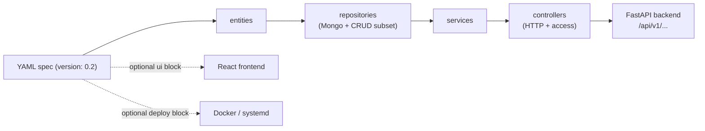

yaml-api-generator turns one declarative YAML file into a running application:
a FastAPI backend (entities, repositories, services, controllers, auth), an
optional React frontend when you add a `ui:` block, and Docker or systemd deploy
artifacts when you add a `deploy:` block.

## How a spec becomes an app



## Quickstart

Install from source, then run any spec on the in-process dev server:

```bash
pip install -e .
yaml-api run myapp.yaml
```

`run` serves on `http://127.0.0.1:8000` by default (change with `--host` and
`-p/--port`). Open `http://127.0.0.1:8000/docs` for the OpenAPI UI.

With `api: { basePath: /api, version: v1 }` in the spec, resources live under
`/api/v1`. For an `entity: post` exposed by a `posts` repository on a controller
with `base_path: /posts`:

```bash
curl http://127.0.0.1:8000/api/v1/posts
```

To generate code instead of serving it, use `build`. The positional target is
`all` (default), `backend`, `frontend`, or `deploy`:

```bash
yaml-api build myapp.yaml -o ./target
```

A `fastapi` backend lands in `./target/backend` and, when the spec has a `ui:`
block, a React app in `./target/frontend`. Pick the backend with
`-t/--target fastapi|drf|raw`.

Specs must declare `version: "0.2"` at the top; omitting it falls back to the
older 0.1 dialect.

## Sections

- [Getting started](/docs/v0.2/getting-started) - install, write your first spec, run it
- [Concepts](/docs/v0.2/concepts) - the model behind entities, repositories, services, controllers, and auth
- [Tutorial](/docs/v0.2/Tutorial/01-hello-world) - step-by-step guide from zero to a working API
- [Reference](/docs/v0.2/Reference/entities/overview) - full specification reference
- [Learn by Example](/docs/v0.2/LearnByExample/blog/01-overview) - real-world example specs
- [Troubleshooting](/docs/v0.2/troubleshooting) - common build, run, and auth errors
